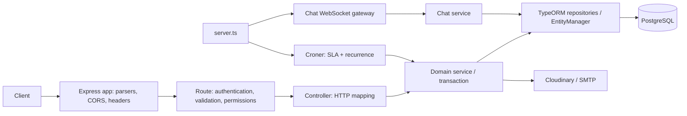
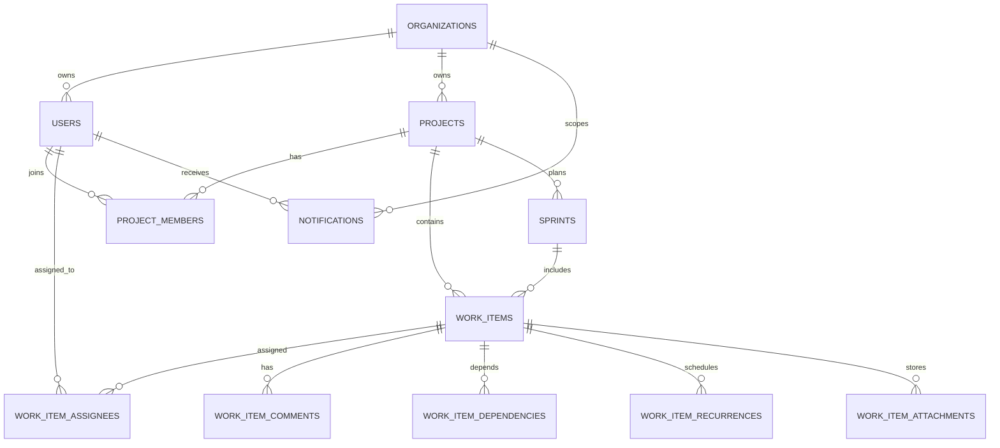

# Backend and Database Architecture Audit

**Audit date:** 2026-10-27  
**Scope:** Current working-tree backend source, entity definitions, migration history, route/controller/service flows, configuration and tests.  
**Method:** Static review plus the existing backend test suite. No database connection, migration, data change, dependency install, or source-code modification was performed.

## 1. Executive Summary

**Overall architecture rating: 5.77/10 weighted.** The application is a feature-rich TypeScript/Express modular monolith using PostgreSQL and TypeORM. Its current boundaries and the newer transactional workflow services are a workable foundation for a small team. The score is held back by unsafe historical attachment-schema evolution, missing database-enforced tenant/project consistency, operational controls that cannot be established from the repository, and tests that do not exercise PostgreSQL or deployed migration paths.

The currently checked-out code has addressed several serious issues documented in earlier workspace reports: work-item assignment no longer creates project memberships, undo requires trusted server-generated state and checks project permission, invitation login requires an active account, chat summaries are paginated, work-item child collections are batch-loaded rather than joined into one fan-out query, and notification delivery is explicitly best-effort. The existing backend tests passed 17/17. These results validate selected code paths, not database migration safety or production behavior.

| Measure | Rating |
|---|---:|
| Overall weighted architecture score | **5.77/10** |
| Backend architecture | 6.5/10 |
| Database architecture | 5.8/10 |
| Authentication, authorization and security | 6.0/10 |
| Maintainability | 5.7/10 |
| Scalability | 5.8/10 |
| Production readiness | **Not established; resolve migration risk and verify operational controls before production** |

### Five biggest strengths

1. The backend is a comprehensible modular monolith with routes, middleware, controllers, domain services, entities, validations, migrations, utilities, a WebSocket gateway and tests; no rewrite or microservices are justified.
2. PostgreSQL and TypeORM provide UUID keys, foreign keys, enums, normalized junction/history tables, and useful uniqueness constraints, including project-key-per-organization and recurrence occurrence uniqueness.
3. Authentication verifies HS256 access tokens and reloads the user's active status, role and organization from the database; project and work-item routes generally enforce resource-level access.
4. Work-item create/update and sprint workflows use transactions; recurrence generation uses database locking and a uniqueness guard; recent code separates notification failure from committed primary writes.
5. Strict TypeScript is enabled. The backend test command passed 17 tests across six suites, including focused regression checks for assignee membership, invitation validation and attachment signatures.

### Five biggest weaknesses

1. `1792266103953-ModifiedEntity` drops attachment metadata and adds required replacement columns without a backfill. Whether it has already run is unknown; a populated-database upgrade can lose data or fail.
2. Tenant/project relationships are generally enforced with separate foreign keys and service checks, not composite database constraints. A future write path or direct SQL can create internally valid but cross-organization/project references.
3. Attachment uploads buffer as much as five 100 MB files in process memory per request. Signature checks improve type validation but do not constrain concurrent aggregate memory use or provide malware scanning.
4. Core list endpoints still return complete child collections for each paginated work item; pagination of parent rows does not bound comments, time entries, children or attachments for an individual item.
5. Tests are focused and pass, but there is no evidence of PostgreSQL-backed migration/upgrade tests, end-to-end tenant-isolation coverage, concurrency tests, production query plans, backup/restore drills or deployment observability.

**Most important improvement to make first:** Establish the deployed schema and migration state, then safely remediate the attachment migration path using a production-like populated database copy, verified backup/restore and a staged corrective migration. Do not edit historical migrations that may already have run.

### Scope and limitations

The backend root is `backend/`. The project uses TypeScript, Express 5, PostgreSQL and TypeORM. The review covered the server/app boot path; all route and middleware areas by responsibility; work-item, project, sprint, audit, chat, notification, invitation, SLA, recurrence and attachment flows; primary entities; migration history; package configuration; and backend tests. Frontend internals were not audited except where needed to understand API contracts.

The worktree was already dirty before this audit, including backend source, migrations, generated output, package files and frontend files. This report assesses the current working-tree contents, which may differ from a deployed commit. No live database was inspected, so the active schema, applied migration history, existing inconsistent rows, query plans, row volumes and backup posture remain unverified. No secrets or environment-variable values are reproduced here.

## 2. Scorecard

Weighted contribution is `weight × rating / 10`. The unrounded contributions sum to **5.765/10**, rounded to **5.77/10**.

| Category | Weight | Rating / 10 | Weighted contribution | Evidence and strengths | Main weakness | Improvement priority |
|---|---:|---:|---:|---|---|---|
| Backend architecture and modularity | 15% | 6.5 | 0.975 | Layered Express modular monolith; focused services for work-item orchestration, SLA, recurrence, chat and attachments. | Some controllers still combine policy, persistence and response shaping; authorization policy is repeated. | Medium |
| Separation of concerns and code organization | 10% | 5.5 | 0.550 | Routes/middleware/controllers/services/entities are recognizable and feature-oriented. | Sprint, audit and list/read operations retain substantial domain/query logic in controllers. | Medium |
| Database schema and relational design | 15% | 5.8 | 0.870 | UUID PKs, FKs, enums, normalized relations, unique project keys, and occurrence/member/assignee constraints. | Composite tenant/project consistency is not enforced; some JSON/`any` mappings are weakly typed. | High |
| Data integrity and transaction management | 10% | 6.2 | 0.620 | Work-item and sprint writes are transactional; recurrence processing uses locks and uniqueness. | Important ownership invariants are not all database constraints; notification delivery is best-effort, not durable. | High |
| API design and consistency | 8% | 6.2 | 0.496 | Joi validation, pagination and explicit error responses exist; label input is now aligned with single-label persistence. | Validation, route aliases, response envelopes and authorization application vary across modules. | Medium |
| Authentication, authorization and security | 12% | 6.0 | 0.720 | Active-user reload, access-token verification, HTTP-only cookies, CORS allow-list, project permissions and recent fixes are present. | No application HTTP rate limiter was found; upload memory budget remains large; database-backed authorization tests are absent. | High |
| Error handling and validation | 7% | 5.5 | 0.385 | Central error handler, `AppError`, async wrapper and Joi schemas exist. | Raw errors are logged; status and validation patterns differ; some fallbacks and catch policies are module-specific. | Medium |
| Performance and scalability | 8% | 5.8 | 0.464 | Pagination exists for major lists; chat summaries use bounded conversation pages and grouped/latest-message queries; indexes cover several filters. | Child collections in work-item responses remain unbounded; query plans and workload data are unavailable; scheduler is process-local. | Medium |
| Migrations and schema evolution | 5% | 3.5 | 0.175 | Migrations are configured and `DB_SYNCHRONIZE` defaults off; production rejects synchronization being enabled. | Attachment migration history has destructive, non-backfilled operations; deployment migration process is external to startup. | **Critical** |
| Testing and reliability | 5% | 4.5 | 0.225 | 17 focused tests pass across six suites. | No demonstrated live-PostgreSQL, migration, concurrency, scheduler, restore or complete resource-authorization tests. | High |
| Maintainability and extensibility | 5% | 5.7 | 0.285 | Feature modules and strict TypeScript offer a reasonable base. | Duplicate package-manager lockfiles, mixed controller/service patterns, loose types and migration history increase change risk. | Medium |
| **Total** | **100%** |  | **5.765 → 5.77/10** |  |  |  |

## 3. Architecture Overview

### Stack and module responsibilities

- **Runtime/language:** Node.js and TypeScript.
- **HTTP framework:** Express 5.
- **Database/ORM:** PostgreSQL and TypeORM.
- **HTTP entry points:** `backend/server.ts` initializes the `DataSource`, starts Croner jobs, creates the HTTP server and attaches the chat WebSocket gateway. `backend/app.ts` configures headers, parsers, CORS, cookies, route mounts and the central error handler.
- **Feature modules:** user/authentication and organizations; projects/members/settings; work items and collaboration; sprints and dashboards; SLA and recurrence; attachments/Cloudinary; notifications; chat; audit logs.
- **Background work:** `backend/services/scheduler.service.ts` runs in-process SLA refresh and recurrence jobs once per minute.
- **Realtime:** `backend/websocket/chat.gateway.ts` authenticates WebSocket connections and delegates chat persistence/access to chat services.
- **External services:** Cloudinary for files and SMTP through the mail service.

### Request, authentication and persistence flow

For bearer-token or cookie-authenticated HTTP requests, `backend/middleware/is.loggedin.ts` verifies HS256 tokens and reloads the user from the database, rejecting inactive accounts. `backend/middleware/project.permission.ts` resolves the project/resource and checks organization and project membership/role; some controllers and services repeat resource checks as defense in depth. Route validation is Joi-based on selected paths, with some validation performed directly in controllers.

The TypeORM `DataSource` loads entities and migrations from `backend/config/data.source.ts`. `DB_SYNCHRONIZE` defaults to false and production configuration rejects it when true. The server does not run migrations at startup; deployment must run them separately and in a controlled release process.

### Principal data relationships

This is a normalized and recognizable starting point. The principal schema weakness is not missing feature tables; it is that several rows carry both organization/project identifiers while FKs validate each identifier independently rather than proving the ownership relationship between them.

### Verified changes in the current source

These are not listed as open defects because the current implementation and focused tests show the relevant changes:

- `validateAssignees` in `backend/services/work-item.service.ts` checks that assignees are active organization users and existing project members without inserting membership records. The assignment tests assert that it performs no writes.
- `undoAuditLog` in `backend/controllers/auditlog.controller.ts` rejects untrusted or project-less audit rows, resolves and locks the work item, verifies project/organization consistency and permission, and applies the stored state in a transaction. Server-side work-item updates set the trusted flag; external audit creation does not.
- `login` rejects non-active users; invitation acceptance uses a hashed one-time token and transaction.
- Work-item validation enforces the persisted single-label contract rather than silently accepting multiple labels.
- Chat conversation listing is paginated and fetches latest messages/unread counts for the selected page. Work-item listing batch-loads child relations instead of multiplying them in one join.
- Notification sends after primary writes are handled through `createNotificationsBestEffort`; this avoids reporting a committed write as failed, but does not guarantee eventual delivery.

## 4. Backend Findings

### B-01 — Large in-memory upload budget can exhaust the backend process

- **Severity:** Medium
- **Confidence:** Confirmed configuration; operational impact depends on concurrent requests and deployment memory.
- **Files/functions:** [`backend/middleware/work.item.attachment.upload.middleware.ts`](./backend/middleware/work.item.attachment.upload.middleware.ts) (`MAX_FILE_SIZE`, `MAX_FILES`, Multer `memoryStorage`, `uploadWorkItemAttachments`); [`backend/services/work.item.attachment.service.ts`](./backend/services/work.item.attachment.service.ts) (`uploadAndPersistWorkItemAttachments`).
- **Evidence:** Multer memory storage accepts up to five files, each up to 100 MB. File-signature checks run after the request files have been buffered. The application has no aggregate request-byte budget in this middleware.
- **Current behavior and root cause:** Each authorized upload can allocate hundreds of megabytes in Node.js before Cloudinary upload begins. Per-file limits are not an aggregate concurrency limit.
- **Consequences and user/business impact:** A small number of simultaneous uploads can cause memory pressure, long garbage-collection pauses or process termination. The signature checks mitigate MIME/extension spoofing but do not scan for malware or protect against oversized concurrent requests.
- **Recommended solution:** Agree a product limit; lower per-file and aggregate request budgets; enforce proxy/request and per-user limits; prefer streaming/direct-to-Cloudinary or object-storage upload for large files. Keep content-signature validation and cleanup of partially uploaded assets.
- **Files likely to change:** Upload middleware, attachment service, proxy/deployment limits and focused upload tests.
- **Complexity:** Medium to Large.
- **Dependencies and risks:** Requires a supported-size decision and storage-flow design; preserve existing authorization, metadata persistence and cleanup behavior.

### B-02 — Work-item list pages still include unbounded child collections

- **Severity:** Medium
- **Confidence:** Suspected performance/API-size risk; query shape is confirmed, runtime impact unmeasured.
- **Files/functions:** [`backend/controllers/task.controller.ts`](./backend/controllers/task.controller.ts) (`getProjectWorkItems`); [`backend/validations/work.item.validations.ts`](./backend/validations/work.item.validations.ts) (list query validation).
- **Evidence:** Parent work items are paginated. For each page the handler batch-loads all assignments, comments, time entries, children and attachments for those work-item IDs and attaches the full result to each response object. This avoids the earlier join fan-out but does not cap the number of child records.
- **Current behavior and root cause:** A single item with extensive comments/time history or a project page with many child records can still produce a large database read and response body. Parent pagination does not bound nested collections.
- **Consequences and user/business impact:** Payload size, database transfer and response serialization can grow with the lifetime of a work item. No production-sized data or measured latency was available, so this is not a measured outage.
- **Recommended solution:** Keep the list response summary-oriented; return counts/latest activity where sufficient and expose separately paginated child endpoints for full history. Preserve current response fields during a versioned or compatible API transition.
- **Files likely to change:** `backend/controllers/task.controller.ts`, a focused read/query service if useful, API contract tests and frontend consumers if the response contract changes.
- **Complexity:** Medium.
- **Dependencies and risks:** Confirm which clients rely on embedded full collections; avoid replacing batch loading with per-item N+1 queries.

### B-03 — No application HTTP rate limiter was found

- **Severity:** Medium
- **Confidence:** Confirmed in repository configuration; a reverse proxy or platform-level control may exist but was not provided.
- **Files/functions:** [`backend/app.ts`](./backend/app.ts) (middleware setup and route mounts); [`backend/routes/user.routes.ts`](./backend/routes/user.routes.ts) (`login`, `refresh`, invitation and registration routes); backend dependencies in [`backend/package.json`](./backend/package.json).
- **Evidence:** The app configures CORS, parsers and headers but does not mount a request rate limiter. No rate-limit dependency or equivalent shared middleware was found in the reviewed route stack.
- **Current behavior and root cause:** Login, refresh, registration, invitation acceptance and other authenticated endpoints depend on deployment infrastructure for request throttling.
- **Consequences and user/business impact:** Password guessing, token-endpoint abuse, invitation/email abuse and request floods may consume backend or external-service capacity. No active abuse or public exposure was established.
- **Recommended solution:** Add limits appropriate to endpoint and identity (IP plus account/email where appropriate), especially authentication and invitation flows; configure trusted proxy handling correctly; return standard `429` responses and monitor throttling.
- **Files likely to change:** `backend/app.ts`, focused auth/invitation route middleware and tests; deployment proxy configuration.
- **Complexity:** Small to Medium.
- **Dependencies and risks:** Deployment topology and proxy trust must be established before relying on IP-based limits; avoid blocking legitimate users behind shared NAT.

### B-04 — Health check and shutdown lifecycle do not demonstrate runtime readiness/recovery

- **Severity:** Medium
- **Confidence:** Confirmed repository behavior; hosting-platform impact requires deployment verification.
- **Files/functions:** [`backend/server.ts`](./backend/server.ts) (`startServer`, server error/close handlers); [`backend/app.ts`](./backend/app.ts) (`GET /health`).
- **Evidence:** `/health` always returns `{ status: "ok" }` without checking the database or scheduler. Startup initializes the database before listening, but the server has no visible SIGTERM/SIGINT handler that stops accepting traffic, drains requests, stops jobs and destroys `AppDataSource`.
- **Current behavior and root cause:** Liveness is exposed, but readiness after a later database failure is not represented; process termination relies on external runtime behavior rather than an explicit graceful shutdown path.
- **Consequences and user/business impact:** An orchestrator may continue routing traffic to a process whose database is unavailable. Abrupt termination can interrupt requests/jobs and complicate connection cleanup. No deployment configuration was available to determine whether the platform compensates.
- **Recommended solution:** Separate liveness from readiness; readiness should report initialized/usable dependencies without exposing sensitive details. Handle termination signals by stopping schedulers, closing the HTTP server and destroying the data source with a bounded timeout.
- **Files likely to change:** `backend/server.ts`, `backend/app.ts`, operational tests and deployment health-check configuration.
- **Complexity:** Small to Medium.
- **Dependencies and risks:** Align readiness semantics and shutdown timeout with the hosting platform and the deployment's migration strategy.

### B-05 — Business and query responsibilities remain concentrated in selected controllers

- **Severity:** Low to Medium
- **Confidence:** Confirmed structural observation; no standalone production defect established.
- **Files/functions:** [`backend/controllers/sprint.controller.ts`](./backend/controllers/sprint.controller.ts) (`createSprint`, read/update/delete handlers); [`backend/controllers/auditlog.controller.ts`](./backend/controllers/auditlog.controller.ts) (`createAuditLog`, `undoAuditLog`); [`backend/controllers/task.controller.ts`](./backend/controllers/task.controller.ts) (`getProjectWorkItems`).
- **Evidence:** These controller modules contain project/resource authorization, transaction/query construction, domain validation or state restoration, and HTTP response mapping. Work-item writes are more cleanly orchestrated in `backend/services/work-item.service.ts`, showing a local pattern available for reuse.
- **Current behavior and root cause:** Similar business decisions and transaction ownership are implemented at different layers and with different patterns.
- **Consequences and user/business impact:** Authorization and workflow semantics are harder to test independently and easier to make inconsistent during changes. No circular dependency or need for repository abstractions was established.
- **Recommended solution:** Extract only meaningful application operations: sprint transaction orchestration, audit undo as a domain operation, and optionally a bounded work-item list query. Keep controllers responsible for HTTP validation/response mapping; reuse the current service patterns rather than adding generic layers.
- **Files likely to change:** The three controllers, one focused service per cohesive workflow only where it reduces policy duplication, and integration tests.
- **Complexity:** Medium.
- **Dependencies and risks:** Preserve endpoint contracts and ensure authorization remains enforced inside resource operations, not only in routes.

### B-06 — Package-manager and lockfile ownership is ambiguous

- **Severity:** Low
- **Confidence:** Confirmed.
- **Files/functions:** [`backend/package.json`](./backend/package.json), `backend/package-lock.json`, `backend/pnpm-lock.yaml`.
- **Evidence:** The backend manifest declares pnpm as the package manager while both npm and pnpm lockfiles exist. `pnpm` is also listed as a dependency; `express-session` and `ts-node-dev` are declared but not referenced by the backend scripts or reviewed TypeScript source.
- **Current behavior and root cause:** Multiple package-resolution artifacts make the authoritative install path unclear.
- **Consequences and user/business impact:** Developers and deployment systems may install different graphs; redundant dependencies increase maintenance and audit noise. No direct runtime defect was established.
- **Recommended solution:** Select and document one package manager/lockfile after checking CI and deployment consumers. Remove only dependencies proven unused by all consumers in a separate dependency-maintenance change.
- **Files likely to change:** Backend manifest, selected lockfile and CI/deployment scripts.
- **Complexity:** Small.
- **Dependencies and risks:** Do not remove packages from source search alone if external tooling depends on them.

## 5. Database Findings

### DB-01 — Historical attachment migration is destructive and unsafe to assume against populated data

- **Severity:** High
- **Confidence:** Confirmed from migration SQL; actual deployed data loss or upgrade failure depends on whether/when it ran and the table contents.
- **Files/functions:** [`backend/migrations/1792266103953-ModifiedEntity.ts`](./backend/migrations/1792266103953-ModifiedEntity.ts) (`up`); subsequent attachment changes in `backend/migrations/1792399247543-AddProjectLabels.ts`, `backend/migrations/1792559847406-AddedComent.ts`, and [`backend/migrations/1793010000000-AddCloudinaryMetadataToWorkItemAttachments.ts`](./backend/migrations/1793010000000-AddCloudinaryMetadataToWorkItemAttachments.ts); current mapping in [`backend/entities/work.item.attachment.entity.ts`](./backend/entities/work.item.attachment.entity.ts).
- **Evidence:** `ModifiedEntity.up` drops attachment `created_at`, `original_name`, `storage_key` and `mime_type`, then adds replacement name/MIME/storage/work-item/uploader columns as required without a backfill/default. The later Cloudinary migration adds nullable `public_id` and `resource_type`; it does not restore metadata removed by the earlier migration.
- **Current behavior and root cause:** The migration chain contains drop-and-recreate transformations instead of preserving data with additive columns, backfill, validation and a later constraint change.
- **Consequences and user/business impact:** On a populated deployment, old attachment metadata can be lost; adding non-null columns without defaults can fail. The exact deployed result cannot be inferred without the migration table and data.
- **Recommended solution:** Inspect deployed migration history, schema and attachment references. Rehearse a new corrective migration against a restored production-like copy. Use additive nullable columns, deterministic backfill and row-count/file-reference verification before enforcing `NOT NULL`. Treat any applied migration as immutable unless a documented migration policy explicitly allows otherwise.
- **Files likely to change:** A new corrective migration, attachment entity only if the schema comparison requires it, migration integration tests and deployment runbook.
- **Complexity:** Large.
- **Dependencies and risks:** Requires a verified backup and restore, an inventory of real attachment rows and external Cloudinary objects, and a rollback/forward-fix plan. Do not execute migrations during this audit.

### DB-02 — Foreign keys do not enforce tenant/project ownership consistency

- **Severity:** Medium
- **Confidence:** Confirmed schema gap; no direct cross-tenant API exploit was established in reviewed normal write paths.
- **Files/entities:** [`backend/entities/work.item.entity.ts`](./backend/entities/work.item.entity.ts), [`backend/entities/project.entity.ts`](./backend/entities/project.entity.ts), [`backend/entities/project.member.entity.ts`](./backend/entities/project.member.entity.ts), [`backend/entities/work.item-assignee.entity.ts`](./backend/entities/work.item-assignee.entity.ts), [`backend/entities/notification.entity.ts`](./backend/entities/notification.entity.ts), [`backend/entities/audit.log.entity.ts`](./backend/entities/audit.log.entity.ts), and migrations under `backend/migrations/`.
- **Evidence:** Work items store both `organizationId` and `projectId`; ordinary FKs validate the project and organization independently, without a composite FK proving that they match. Similar separately valid IDs exist for project/user memberships, work-item/user assignments, sprint/label relationships, notifications and audit entries. Service code validates a number of these relationships, but direct SQL, imports and future code paths do not inherit those checks.
- **Concrete read path:** `getProjectWorkItems` in `backend/controllers/task.controller.ts` loads children using only `parentWorkItemId IN (page work-item IDs)`. If a malformed cross-project parent pointer exists, the child is returned with the authorized parent's response because that secondary query does not also constrain organization/project. Normal service writes check parent scope; the risk requires an inconsistent row or a future writer that omits that check.
- **Current behavior and root cause:** Tenant identity is denormalized across related records without matching composite constraints.
- **Consequences and user/business impact:** A future bug or administrative/import write could create a cross-organization or cross-project relationship that later queries may treat as valid. This is a data integrity and defense-in-depth risk, not proof that current routes allow cross-tenant reads.
- **Recommended solution:** Define the organization-membership model and required same-project rules. Inventory and repair inconsistent rows first, then add candidate unique keys and composite FKs for core ownership relationships where practical. Retain service-level authorization and validate behavior with mismatched-ID integration tests.
- **Files likely to change:** Entities and additive corrective migrations; work-item/project/sprint/assignment write tests.
- **Complexity:** Large.
- **Dependencies and risks:** Must confirm whether users can be organization-less or belong to multiple organizations. Composite constraints may require staged deployment and pre-existing-data cleanup.

### DB-03 — Migration execution is deployment-owned and not verified by startup

- **Severity:** Medium
- **Confidence:** Confirmed configuration; deployment process is unknown.
- **Files/functions:** [`backend/config/data.source.ts`](./backend/config/data.source.ts) (`AppDataSource`); [`backend/config/config.ts`](./backend/config/config.ts); [`backend/server.ts`](./backend/server.ts) (`startServer`).
- **Evidence:** Migrations are registered in the TypeORM data source, synchronization defaults off and is explicitly rejected when production has it enabled. `startServer` initializes the data source but does not run migrations.
- **Current behavior and root cause:** Schema evolution is intentionally separate from application boot, but the repository does not establish a CI/deployment migration step or prove fresh-install and upgrade paths.
- **Consequences and user/business impact:** A deployment can run code against a stale schema if the external release process omits or misorders migrations. Automatically synchronizing in production is correctly guarded against.
- **Recommended solution:** Keep production synchronization disabled. Establish an explicit, reviewed migration job in deployment; verify clean bootstrap and upgrade from the supported prior schema using PostgreSQL integration tests.
- **Files likely to change:** Deployment/CI configuration and migration tests; no startup auto-migration is recommended without an operational design.
- **Complexity:** Medium.
- **Dependencies and risks:** Coordinate migration ordering and application compatibility during rolling deployments; no live deployment configuration was available for inspection.

### DB-04 — Useful indexes exist, but read-path indexes and nested-result bounds need measurement

- **Severity:** Low to Medium
- **Confidence:** Static assessment; no database plans, row counts or production metrics available.
- **Files/entities/functions:** Index decorators in `backend/entities/work.item.entity.ts`, `backend/entities/chat-message.entity.ts`, `backend/entities/notification.entity.ts`, `backend/entities/audit.log.entity.ts` and `backend/entities/work.item.recurrence.entity.ts`; query in `backend/controllers/task.controller.ts` (`getProjectWorkItems`).
- **Evidence:** The schema has organization/project/status/type/parent/SLA indexes for work items; conversation/time for chat messages; user/read/time for notifications; project/org/time for audit; and active/next-run for recurrence. The default work-item list filters by project and orders by `createdAt`/ID without an explicit matching composite index. The endpoint also loads all child collections for each page.
- **Current behavior and root cause:** Existing indexes cover many filters, but the actual workload and plans are unknown, and an index alone cannot bound nested result sizes.
- **Consequences and user/business impact:** At scale, the list may sort/scan more rows than necessary and transfer large nested results. This is a potential cost, not a measured slow query.
- **Recommended solution:** Bound response shape first (B-02), then inspect `EXPLAIN (ANALYZE, BUFFERS)` with representative PostgreSQL data. Consider `(project_id, created_at DESC, id DESC)` only if the plan and query workload justify its write/storage cost.
- **Files likely to change:** Potential additive index migration and list query/contract tests.
- **Complexity:** Small to Medium after measurement.
- **Dependencies and risks:** Production-sized data, realistic status filters and API pagination must be represented before selecting indexes.

### DB-05 — Domain invariants need explicit ownership between service and database

- **Severity:** Low to Medium
- **Confidence:** Confirmed for schema/application boundary; individual product semantics need confirmation.
- **Files/entities/functions:** [`backend/entities/work.item.dependency.entity.ts`](./backend/entities/work.item.dependency.entity.ts), [`backend/entities/project.workflow.entity.ts`](./backend/entities/project.workflow.entity.ts), [`backend/entities/organization.sla.entity.ts`](./backend/entities/organization.sla.entity.ts), [`backend/entities/work.item.time.entry.entity.ts`](./backend/entities/work.item.time.entry.entity.ts), and their related validators/controllers.
- **Evidence:** Core scalar types and enum columns enforce valid primitive shapes, and there are checks for project/sprint date ordering and positive recurrence intervals. Dependency uniqueness does not by itself prevent a multi-item cycle; workflow content is JSONB/loosely typed; and the reviewed schema does not consistently express business bounds for SLA/time-entry values as database checks.
- **Current behavior and root cause:** Some rules are application-level conventions while others are database-enforced; the boundary is not consistently documented.
- **Consequences and user/business impact:** Alternate writers can persist values accepted by PostgreSQL but invalid for the application; invalid graph/workflow state can make future features difficult to reason about. Whether cycles or custom statuses are invalid is a product rule not established by this static review.
- **Recommended solution:** Document invariant ownership. Add database checks for simple non-negotiable scalar constraints after validating existing data; keep cross-row/domain rules in transactional services and add tests. Decide whether dependency cycles and editable workflow statuses are permitted before imposing constraints.
- **Files likely to change:** Relevant entity/migration and validation/service files, after domain decisions.
- **Complexity:** Small to Large depending on cycle or workflow semantics.
- **Dependencies and risks:** Avoid changing product semantics or adding constraints before examining existing data and API consumers.

### Database strengths to retain

Keep the normalized member/assignee/comment/time-entry/dependency/recurrence/occurrence/chat/audit tables, UUID identities, core foreign keys, organization-scoped project-key uniqueness, composite member/assignee keys, one workflow per project, one SLA policy per organization and unique recurrence occurrence guard. The evidence does not justify replacing PostgreSQL/TypeORM or introducing CQRS/event sourcing.

## 6. Separation-of-Concerns Plan

This plan is limited to boundaries tied to findings; it does not propose a service for every small handler.

| File(s) | Existing responsibilities | Keep | Move or clarify | Dependency flow and justification | Risk / priority |
|---|---|---|---|---|---|
| [`backend/middleware/work.item.attachment.upload.middleware.ts`](./backend/middleware/work.item.attachment.upload.middleware.ts), [`backend/services/work.item.attachment.service.ts`](./backend/services/work.item.attachment.service.ts) | Multipart parsing, size/type checks, buffering, Cloudinary upload, metadata persistence and cleanup. | Authentication/resource permission before upload; signature checks; cleanup of unpersisted remote assets. | Define an aggregate upload budget and, if large files are supported, stream/direct upload with explicit quotas. | Route → authorization → bounded upload middleware → storage/persistence service. Directly addresses B-01 without mixing storage code into task CRUD. | Medium–Large; preserve Cloudinary cleanup and API compatibility. |
| [`backend/controllers/task.controller.ts`](./backend/controllers/task.controller.ts), [`backend/services/work-item.service.ts`](./backend/services/work-item.service.ts) | Controller handles HTTP mapping and list query/child loading; service owns transactional create/update and policy checks. | Current work-item orchestration transaction and validation flow. | Move list selection/assembly into a focused read query only if it meaningfully bounds nested data; avoid a generic repository layer. | Route/permission → controller → list query service → repositories. Addresses B-02 and makes payload cost explicit. | Medium; inspect frontend contract first. |
| [`backend/app.ts`](./backend/app.ts), [`backend/routes/user.routes.ts`](./backend/routes/user.routes.ts) | Middleware stack, route mounts and authentication/invitation route declaration. | Central middleware and route modules. | Add focused rate-limiting policy for login/refresh/invites and configure trusted proxy rules at the edge. | App/route middleware → controller. Directly covers B-03; avoid over-throttling shared networks. | Small–Medium; deployment topology dependency. |
| [`backend/server.ts`](./backend/server.ts), [`backend/app.ts`](./backend/app.ts) | Startup, data-source initialization, scheduler lifecycle, HTTP server lifecycle and health endpoint. | Explicit initialization before listening and scheduler start/stop functions. | Add readiness semantics and signal-driven bounded shutdown that closes HTTP, schedulers and the database. | Process lifecycle owns dependencies; routes expose health/readiness separately. Addresses B-04. | Small–Medium; align with orchestrator semantics. |
| [`backend/controllers/sprint.controller.ts`](./backend/controllers/sprint.controller.ts) | Sprint validation, project policy, transactional database changes, work-item assignment and HTTP responses. | Thin request/response behavior and endpoint-specific parsing. | Extract cohesive create/update transaction orchestration only if it enables independent testing and consistent permission rules. | Controller → sprint application operation → transaction/repositories. Reduces mixed concerns noted in B-05. | Medium; do not break sprint API contract. |
| [`backend/controllers/auditlog.controller.ts`](./backend/controllers/auditlog.controller.ts), [`backend/routes/project.routes.ts`](./backend/routes/project.routes.ts) | Audit route compatibility, log input, authorization, snapshot validation, transactional undo and response mapping. | Current requirement for trusted server state and resource authorization. | Consider extracting undo as an application operation; keep a single policy definition and test both scoped and compatibility routes. | Route → project policy → audit operation → transaction. This preserves current protections and improves independent tests. | Medium; retain legacy audit-history behavior. |
| [`backend/services/sla.service.ts`](./backend/services/sla.service.ts), [`backend/services/scheduler.service.ts`](./backend/services/scheduler.service.ts) | SLA calculations and eligibility/state transition; scheduling and local overlap guards; notification dispatch. | Domain calculation in SLA service and short transaction around row updates. | Keep eligibility/batch query testable; document single-process versus multi-replica execution and notification durability policy. | Scheduler → bounded worker transaction → best-effort notification or future outbox only if required. | Medium; validate PostgreSQL locking and deployment topology. |
| [`backend/services/chat.service.ts`](./backend/services/chat.service.ts) | Conversation policy, membership, messages, pagination and conversation summaries. | Current paginated conversation list, grouped unread query and transactional message/timestamp write. | Avoid full-history summaries; keep page/cursor semantics explicit and tested. | Controller/WebSocket → chat service → bounded SQL. | Low–Medium; no need to split further absent measured scale. |
| [`backend/entities/work.item.entity.ts`](./backend/entities/work.item.entity.ts), ownership entities and migrations | Domain entities, foreign keys, repeated tenant/project IDs and indexes. | Existing normalized schema and useful keys/indexes. | Design composite ownership constraints after data and organization-model review; keep access policy in application services too. | Services validate commands; DB constraints prevent invalid writes from any path. | Large; coordinate with DB-02 and existing data. |
| `backend/migrations/1792266103953-ModifiedEntity.ts` and attachment migrations | Historical schema evolution. | Applied migrations as immutable history. | Add a new corrective migration only after inventory/backfill/rehearsal; add upgrade tests. | Reviewed migration job → additive migration → verify → enforce constraints. | Critical; see DB-01. |
| [`backend/package.json`](./backend/package.json), `backend/package-lock.json`, `backend/pnpm-lock.yaml` | Dependency declarations and package-manager install state. | Dependencies required by runtime and tooling. | Select one package manager and lockfile after verifying CI/deployment consumers. | Reproducible installation reduces maintenance variance; addresses B-06. | Low; isolate from feature work. |

### Responsibilities that should remain as they are

- Keep the modular monolith and feature-oriented directory structure; no evidence supports microservices.
- Keep recurrence date/occurrence logic in a focused domain service and retain the recurrence occurrence uniqueness constraint.
- Keep primary database transactions short. Do not hold database transactions open during SMTP or Cloudinary calls.
- Keep project/resource authorization checks even after adding database constraints; FKs are not authorization.
- Keep notification delivery best-effort unless the product requires durable eventual delivery; introduce an outbox only with defined retry, deduplication and monitoring semantics.

## 7. Prioritized Remediation Roadmap

| Phase / task | Finding IDs | Dependencies | Expected benefit | Complexity | Acceptance criteria |
|---|---|---|---|---|---|
| **Phase 1 — Critical correctness and security:** agree file size/aggregate limits; enforce request and per-user upload budgets; plan streaming for large assets. | B-01 | Supported file sizes, proxy limits and storage provider flow. | Reduces memory-exhaustion risk while preserving file validation. | Medium–Large | Concurrent uploads at the configured maximum stay within an explicit memory budget; oversized requests receive a documented 413; cleanup tests pass. |
| Add login/refresh/invitation rate limits and confirm proxy trust. | B-03 | Deployment topology and trusted proxy configuration. | Reduces credential guessing and endpoint abuse. | Small–Medium | Repeated requests exceed limits with 429; valid users behind shared NAT are handled per policy; tests cover endpoint-specific limits. |
| **Phase 2 — Database integrity:** inventory deployed migration/schema/data and safely remediate attachment history. | DB-01, DB-03 | Restored production-like database, backup/restore validation and deployment migration history. | Prevents attachment loss and release-blocking migration failure. | Large | Clean install and upgrade fixtures pass; attachment metadata and external file references reconcile; migration is rehearsed and rollback/forward-fix plan is approved. |
| Define tenant/project invariants and add composite constraints where suitable. | DB-02, DB-05 | Organization membership model; data-quality report and cleanup plan. | Prevents cross-scope references regardless of writer. | Large | Mismatched organization/project references fail at DB layer; valid workflows pass PostgreSQL integration tests; legacy rows are accounted for. |
| Establish migration job and compatibility policy for releases. | DB-03 | CI/deployment ownership and release topology. | Avoids code/schema drift across environments. | Medium | Deployment explicitly runs reviewed migrations; production sync is disabled; fresh setup and supported upgrade paths pass. |
| **Phase 3 — Backend architecture:** bound list response shape and extract only the read operation needed to support it. | B-02, B-05 | Client contract review and pagination semantics. | Predictable payload/query costs and independently testable read behavior. | Medium | Large child histories do not produce unbounded list payloads; endpoint response compatibility is documented and tests cover pagination. |
| Add readiness and graceful shutdown behavior. | B-04 | Hosting platform health-check and termination timeout requirements. | Avoids routing to unavailable dependencies and reduces interrupted work. | Small–Medium | Readiness reflects DB state; SIGTERM stops schedulers, drains HTTP and closes TypeORM within the platform timeout. |
| **Phase 4 — Performance and scalability:** profile key queries and add only measured indexes; validate scheduler behavior on target PostgreSQL. | DB-04, B-02 | Representative data volume and plans. | Addresses actual bottlenecks without unnecessary write overhead. | Small–Medium | `EXPLAIN (ANALYZE, BUFFERS)` and response-size/query-count baselines are recorded; any index has evidence and write-cost review. |
| Document multi-replica scheduler ownership and notification delivery guarantee. | B-04, DB-03 | Deployment replica topology and product notification SLA. | Prevents assumptions about local job guards and lost notifications. | Medium; large only if an outbox is required | Concurrent workers do not duplicate recurrence/escalation effects; retry/dedup behavior and monitoring are documented. |
| **Phase 5 — Testing and maintainability:** add PostgreSQL-backed migration, authorization, transaction and concurrency coverage. | DB-01–DB-05, B-01–B-05 | Test database/CI infrastructure. | Turns static assumptions into repeatable guarantees. | Medium–Large | CI exercises migration bootstrap/upgrade, tenant mismatch rejection, upload limits, resource permissions, scheduler locking and rollback behavior against PostgreSQL. |
| Choose one backend package manager and lockfile; review dependency consumers. | B-06 | CI/deployment scripts inventory. | Reproducible installs and reduced maintenance noise. | Small | Documented install path produces a clean lockfile-consistent install in CI; unused packages are removed only after consumer checks. |

## 8. Production Readiness Checklist

“Pass” means the repository provides direct code evidence for the control, not that it has been independently penetration-tested or validated in production.

| Control | Status | Evidence / required verification |
|---|---|---|
| Password hashing | **Pass (code-level)** | `bcrypt` is used in registration and invitation acceptance. Verify password lifecycle and production configuration separately. |
| Access-token validation and active-user check | **Pass (code-level)** | JWT verification restricts the algorithm and reloads active user state. Verify refresh/revocation behavior and secret rotation in deployment. |
| Project/resource authorization | **Needs verification** | Shared middleware and service checks are present, and recent fixes close previously documented assignment/undo paths. Full endpoint/resource authorization needs PostgreSQL-backed negative tests. |
| Tenant isolation | **Needs verification** | Normal paths scope project/work-item access to organization; composite DB constraints and tenant integration coverage are missing. |
| Request validation | **Needs verification** | Joi validation covers selected endpoints, with additional controller validation. Review all query/body/path schemas and API contracts before release. |
| HTTP rate limiting and abuse controls | **Fail (repository-level)** | No application-level limiter was found. Verify whether an equivalent platform/proxy control exists; add application limits for sensitive endpoints. |
| CORS allow-list | **Pass (code-level)** | Configured origins are checked and credentials enabled. Verify production origin values and WebSocket origin handling. |
| Security headers | **Pass (partial code-level)** | `app.ts` sets `nosniff`, frame denial, referrer and permissions policy; HSTS is conditional on production. CSP and deployment TLS/proxy policy need verification. |
| SQL injection resistance | **Needs verification** | Reviewed access queries predominantly use TypeORM parameters. Review all query fragments and run security tests; no injection finding was established here. |
| File upload resource limits | **Fail** | Memory storage permits five files of up to 100 MB each; no aggregate/per-user limit is evident. Signature validation is present. |
| Migration safety | **Fail / Needs verification** | Historical attachment migration is destructive and non-backfilled. Deployed migration state and production-like upgrade behavior are unknown. |
| Production schema synchronization | **Pass (code-level)** | Defaults off and production rejects `DB_SYNCHRONIZE=true`; verify actual environment configuration. |
| Migration deployment process | **Needs verification** | Migrations are registered but not run by startup. Confirm a reviewed migration job exists for every environment. |
| Transactions and concurrency | **Needs verification** | Transactions, row locks and unique occurrence keys exist; no DB-backed transaction/concurrency tests were found. |
| SLA and recurrence scheduling | **Needs verification** | In-process Croner jobs and processing locks are present. Validate multi-replica behavior, missed-run recovery and shutdown in deployment. |
| Notification reliability | **Needs verification** | Best-effort delivery prevents false request failures, but failures are not durably retried. Confirm the product's delivery expectation and log monitoring. |
| Error handling and log redaction | **Needs verification** | Central error handler returns generic 5xx messages, but logs raw errors. Verify SQL/PII redaction, structured logging, retention and access controls. |
| Liveness/readiness and graceful shutdown | **Fail (repository-level)** | `/health` is static; no signal-driven graceful shutdown/database close was found. A platform may mitigate, but no configuration evidence was provided. |
| Monitoring and alerting | **Needs verification** | No repository evidence establishes metrics, tracing or alerting; verify platform coverage. |
| Backups and recovery | **Needs verification** | Repository does not establish DB backup/restore or Cloudinary recovery; test restore and document RPO/RTO. |
| Automated tests | **Needs verification** | Existing backend command passed 17 tests. This is useful focused coverage but not sufficient evidence for database, migrations or production readiness. |
| Deployment secrets and environment validation | **Needs verification** | Access-token secret length is checked without exposing values. Confirm secret provisioning/rotation, database credential policy and production env validation externally. |

## 9. Final Verdict

1. **Is the current architecture suitable for a small team?**  
   **Yes.** A modular Express/TypeORM monolith is understandable for the current feature set. Keep it; focus on data safety, policy tests and operational controls rather than splitting services.

2. **Is it maintainable as the application grows?**  
   **With targeted investment.** The feature modules and work-item services are a good base, but migration history, repeated authorization/domain policy, large controller responsibilities and unbounded nested response data will raise change risk over time.

3. **Is the database schema correctly designed for the current domain?**  
   **Partially.** It is broadly normalized and uses useful keys, foreign keys and indexes. It does not consistently enforce cross-organization/project relationships, and attachment migration history is not safe to assume against populated deployments.

4. **What are the three greatest risks?**  
   - Attachment metadata loss or blocked rollout from historical schema changes (DB-01).
   - Cross-tenant/project references not prevented by composite constraints (DB-02).
   - Large in-memory uploads causing backend memory pressure, compounded by no repository-level request throttling (B-01, B-03).

5. **Which parts should not be refactored?**  
   Retain the modular monolith, normalized feature tables, project-key and recurrence uniqueness constraints, short transactional work-item/sprint writes, and recurrence date logic. Do not introduce microservices, CQRS, event sourcing or generic repositories without demonstrated need.

6. **Which parts most urgently need refactoring?**  
   First address migration/data safety around attachments. Next bound the upload budget and add abuse limits. Then enforce tenant/project consistency and reduce unbounded nested work-item list payloads.

7. **Which improvements produce the greatest benefit for the least effort?**  
   Define a smaller aggregate upload budget and verify proxy limits; add focused rate limiting to login/refresh/invitation routes; and add tests that assert resource authorization and tenant mismatch behavior. The migration issue has the highest impact but requires more investigation and rehearsal.

8. **What must be addressed before production deployment?**  
   Establish actual migration state and rehearse the attachment upgrade on a production-like restored database; verify backup/restore; keep synchronization disabled; provide rate limiting and bounded uploads; test tenant/resource authorization on PostgreSQL; and confirm readiness, graceful shutdown, scheduler topology, logging and monitoring.

9. **What rating would you give the architecture today?**  
   **5.77/10 weighted.** This reflects a credible feature-oriented foundation and several recent targeted fixes, offset by migration/data-integrity risk, incomplete tenant constraints, operational controls not evidenced in-repository and limited integration coverage.

10. **What rating could reasonably be achieved after addressing the identified problems?**  
    **7.5–8/10** is achievable without a rewrite if migration safety is demonstrated, tenant invariants are explicit and tested, uploads and list responses are bounded, authorization is covered end-to-end, and deployment/recovery practices are verified.

The score is a repository-level baseline, not a production assessment. Live migration state, database query plans, row volumes, multi-replica behavior, external-service reliability, backups and platform controls could change these conclusions.
