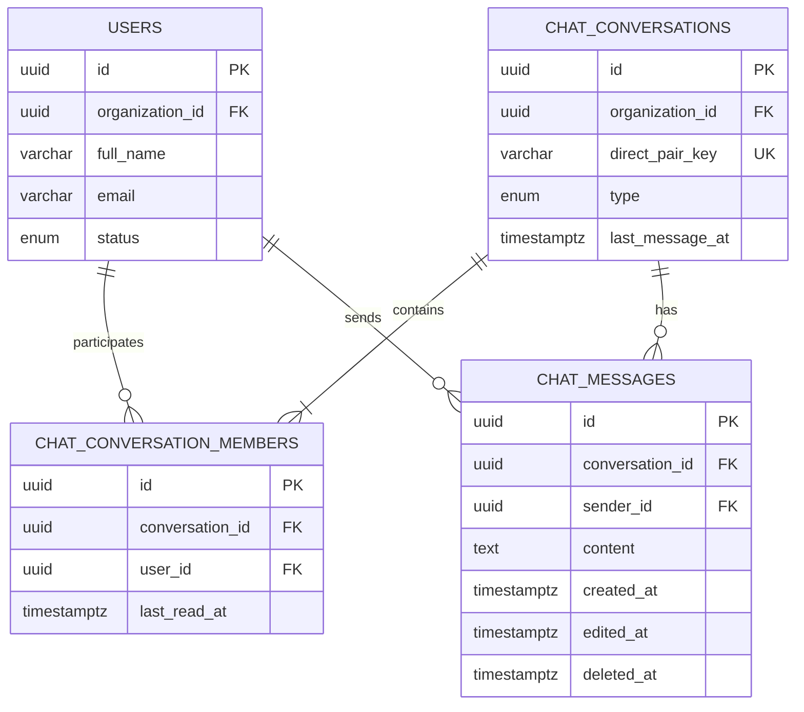

# TaskFlow Chat Feature

## What was added

### Backend

- Added PostgreSQL/TypeORM entities for conversations, conversation members,
  and messages.
- Added migration `1792400000000-AddChatTables.ts`.
- Added authenticated REST endpoints under `/api/chat` (with the existing
  `/api/conversations` compatibility alias):
  - Create and list conversations.
  - List active organization members.
  - Read conversation details.
  - Send messages and mark conversations as read.
  - Add or remove members.
  - Retrieve paginated message history.
- Added migration `1792700000000-AddDirectChatConstraints.ts` for direct-pair
  uniqueness, read timestamps, message soft-delete metadata, and indexes.
- Added authorization checks for organization, project, and conversation
  membership boundaries.
- Added WebSocket support at `/ws/chat` using the existing HTTP server.
- Added JWT/cookie authentication, origin validation, payload limits, rate
  limiting, membership checks, room cleanup, and persistence-before-broadcast
  behavior.

### Frontend

- Added a Chat page at `#/chat`.
- Added a Chat item to the global navigation rail.
- Added conversation list and direct-conversation creation.
- Added message history loading.
- Added WebSocket join, leave, receive, and send behavior.
- Added duplicate-message protection and connection error feedback.
- Added typed chat API helpers.

## How to run

From `backend`:

```sh
node --require ts-node/register ./node_modules/typeorm/cli.js migration:run -d config/data.source.ts
pnpm dev
```

From `frontend`:

```sh
pnpm dev
```

Set `VITE_API_URL` when the backend is not available at
`http://localhost:3000`. The WebSocket URL is derived automatically:
`http://` becomes `ws://`, and `https://` becomes `wss://`.

## User flow

1. Sign in normally.
2. Select **Chat** in the left navigation rail.
3. Select **New conversation**.
4. Choose one active organization teammate.
5. Open the conversation and send messages.
6. Messages are saved by the backend before being broadcast to authorized
   connected members.

Direct conversations are strictly one-to-one: the authenticated user and
exactly one selected teammate. Opening the same teammate again reuses the
existing direct conversation instead of creating a duplicate. Direct
conversation members cannot be added or removed through the member API.

The canonical REST contract is:

- `GET /api/chat/members`
- `GET /api/chat/conversations`
- `POST /api/chat/conversations` with `{ "participantId": "UUID" }`
- `GET /api/chat/conversations/:conversationId/messages?limit=30&before=ISO_DATE`
- `POST /api/chat/conversations/:conversationId/messages` with `{ "content": "..." }`
- `PATCH /api/chat/conversations/:conversationId/read`

## Sender and receiver database diagram



For a direct conversation, the receiver is the other row in
`CHAT_CONVERSATION_MEMBERS`. The message stores the authenticated sender in
`CHAT_MESSAGES.sender_id`; the receiver is resolved through the conversation's
other participant rather than copied into every message.

## WebSocket protocol

Client events:

```json
{"event":"conversation:join","conversationId":"UUID"}
{"event":"conversation:leave","conversationId":"UUID"}
{"event":"message:send","conversationId":"UUID","content":"Hello"}
```

Server events:

```json
{"event":"conversation:joined","conversationId":"UUID"}
{"event":"message:new","data":{"id":"UUID","conversationId":"UUID","senderId":"UUID","content":"Hello","createdAt":"ISO_DATE"}}
{"event":"chat:error","message":"Safe error message"}
```

## Validation performed

- Backend TypeScript typecheck.
- Backend automated tests.
- Frontend TypeScript typecheck and production build.
