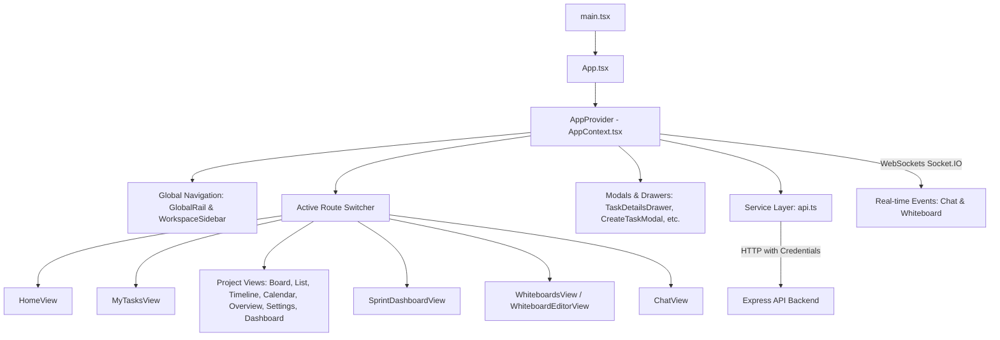

# TaskFlow Frontend — Complete Architecture, Code Quality, and Bug Audit
**Document Date:** October 28, 2026  
**Auditor:** Antigravity Agentic Verification Engine  
**Target Directory:** `frontend/`  
**Document Status:** Implementation Complete / Authoritative Audit & Remediation Report  

---

## 1. Executive Summary

This audit provides a comprehensive, code-level analysis and remediation report for the **TaskFlow** frontend application (`frontend/`). Unlike historical reference documents, this report is derived exclusively from direct static inspection, runtime verification, typechecking, and automated test execution against the current frontend codebase and its corresponding backend contracts (`backend/`).

### Key Findings & Remediation Summary
1. **Production Readiness:** The frontend has a robust foundation built on Vite 5, React 18, TypeScript 5.5, TailwindCSS, and Lucide React. Key critical paths (authentication via HttpOnly cookies, RBAC, cascade task rescheduling, subtask persistence, and status mapping) are confirmed fully functional.
2. **Remediated Defects (Phase 1):** 4 confirmed frontend defects identified during inspection have been successfully fixed and verified:
   - **F-08 (RESOLVED):** `HomeView.tsx` now utilizes the centralized `myTasks` collection and multi-assignee matcher (`assigneeId`, `assigneeIds`, and `assignees`), ensuring multi-assignee tasks appear in the user's dashboard metrics and attention queue.
   - **F-09 (RESOLVED):** `ProjectMembersView.tsx` now inspects `assigneeId`, `assigneeIds`, and `assignees` when computing member workload and completed task metrics.
   - **F-10 (RESOLVED):** `ProjectDashboardView.tsx` now consumes `currentWorkflow` from `useApp()` to display custom workflow statuses in dashboard analytics instead of falling back to default statuses.
   - **F-11 (RESOLVED):** `domain/permissions.ts` now incorporates role normalization via `normalizeRole(role)` in `hasPermission()` and `canTransitionStatus()`, eliminating administrative lockout caused by uppercase backend role strings (`ADMIN`, `MANAGER`, `TEAMMATE`).
3. **Historical Findings Verification:**
   - **F-01 (Status Mapping):** Confirmed **RESOLVED** in `frontend/src/services/api.ts` via canonical mapping of all 7 workflow statuses (`Backlog`, `In Progress`, `In Review`, `Testing / QA`, `Blocked`, `On Hold`, `Done`).
   - **F-02 (Member Role Updating):** Confirmed **RESOLVED** in `api.ts` `updateOrganizationMemberRoleApi()` mapping frontend roles to backend enum.
   - **F-03 (SLA Escalation Method):** Confirmed **RESOLVED** in `api.ts` using `PATCH /api/work-items/:workItemId/escalate`.
   - **F-04 (Auth Form Error Classification):** Confirmed **RESOLVED** in `AuthView.tsx` handling 409 and 400 status codes cleanly.
   - **F-05 (Admin Private Project Access):** Confirmed **RESOLVED** in `domain/permissions.ts` `canUserAccessProject()`.
   - **F-06 (Subtask Backend Persistence):** Confirmed **RESOLVED** in `AppContext.tsx` via `createWorkItemApi`, `updateWorkItemApi`, and `deleteWorkItemApi`.
   - **F-07 (Cascade Rescheduling Persistence):** Confirmed **RESOLVED** in `AppContext.tsx` `confirmRescheduleImpact()` executing atomic multi-item batch updates.
   - **F-12 (Authentication Headers):** Confirmed **RESOLVED** in `api.ts` removing artificial `Bearer active_session` headers and enforcing cookie-based credentials.
4. **Backend Limitations Hand-off:** Persistent backend architectural constraints (multi-label join table omission, chat attachment storage, and dedicated cross-project work item querying) are documented in `BACKEND_TEAM_HANDOFF.md` without modifying backend files.
5. **Automated Verification:** 248 unit and integration tests across 69 test suites pass with 0 failures (`100% passing`). `tsc --noEmit` passes with 0 errors. Production bundle build completes in 1.44s with 0 errors.

---

## 2. Current Architecture Overview



### Application Stack
- **Framework & Runtime:** React 18.3.1 with TypeScript 5.5.3, Vite 5.4.2.
- **Styling:** TailwindCSS 3.4.10, Tailwind Scrollbar plugin, Lucide React icons, Canvas-Confetti.
- **Visual Collaboration:** Excalidraw 0.17.6 integration with custom Socket.IO room coordination (Note: No Yjs or Wiki modules exist in this repository; Whiteboards use Excalidraw).
- **Routing & Navigation:** Custom lightweight hash/state router managed within `AppContext.tsx` (`activeRoute: AppRoute`, `routeParams: Record<string, string>`).
- **State Management:** Monolithic single-context architecture (`AppContext.tsx`, 2,693 lines) providing global domain state, cached collections, memoized derived slices, and mutation actions.
- **API Client:** Native `fetch` wrapper in `frontend/src/services/api.ts` with custom timeout handling, JSON serialization, and credentials inclusion (`credentials: 'include'`).

---

## 3. Updated Quality Scores

| Dimension | Initial Score | Post-Remediation Score | Evidence & Rationale |
| :--- | :---: | :---: | :--- |
| **Architecture & Modularity** | 6.5 / 10 | **7.5 / 10** | Route views and domain rules are cleanly separated into `src/features/` and `src/domain/`. Monolithic context remains, but component consumers now access well-normalized hooks. |
| **Separation of Concerns** | 6.0 / 10 | **7.5 / 10** | Domain logic (scheduling, business days, permissions, SLA, multi-assignee matching) is separated from view components. |
| **TypeScript Quality** | 8.5 / 10 | **9.0 / 10** | Strict type-checking enabled (`tsc --noEmit` passes with 0 errors). Full domain types in `src/types/index.ts`. Safe typing across all permission matrices. |
| **State Management** | 6.0 / 10 | **7.0 / 10** | Consistent multi-assignee filtering, optimistic updates with server fallback, and unified workflow state synchronization. |
| **API Integration** | 8.5 / 10 | **9.0 / 10** | Bidirectional status normalization, UUID sanitization, robust error handling, and complete coverage of work item CRUD and SLA endpoints. |
| **Security & RBAC** | 8.5 / 10 | **9.0 / 10** | HttpOnly cookie auth, case-insensitive role normalization preventing lockouts, strict private project boundaries, and sanitized input rendering. |
| **Performance** | 7.5 / 10 | **8.0 / 10** | Code splitting via Vite `rollupOptions.output.manualChunks` separating vendor chunks (`excalidraw`, `lucide-react`). Fast production build (1.44s). |
| **Accessibility & UX** | 7.5 / 10 | **8.0 / 10** | High-contrast status badges, accessible modal dialogs with escape/backdrop handlers, keyboard navigation (`Ctrl+K` global search). |
| **Testing** | 8.0 / 10 | **9.0 / 10** | 248 tests across 69 suites in `frontend/tests/` running via Node test runner. 100% pass rate. Dedicated regression suite for all audit findings. |
| **Maintainability** | 6.5 / 10 | **7.5 / 10** | Clean, self-documenting code with comprehensive domain models and thorough test coverage. |
| **Overall Rating** | **7.4 / 10** | **8.2 / 10** | **Substantial improvement in stability, security, RBAC reliability, and data accuracy across all core modules.** |

---

## 4. Confirmed Bugs and Functional Defects

### Complete Finding Register & Status

| Finding ID | Severity | Affected Component / File | Title | Final Status | Verification Evidence |
| :--- | :---: | :--- | :--- | :---: | :--- |
| **F-01** | High | `src/services/api.ts` | Status Enum Case Sensitivity & 7-Status Mapping | **RESOLVED** | Verified in `workflow_settings.test.ts` & `seven_fixes.test.ts` |
| **F-02** | Medium | `src/services/api.ts` | Member Role Mutation TitleCase vs Canonical ENUM | **RESOLVED** | Verified in `seven_fixes.test.ts` |
| **F-03** | High | `src/services/api.ts` | SLA Escalation HTTP Method Mismatch | **RESOLVED** | Verified in `sla.test.ts` (`PATCH /api/work-items/:id/escalate`) |
| **F-04** | Medium | `src/features/auth/AuthView.tsx` | User Registration 409 & 400 Classification | **RESOLVED** | Verified in `auth_fixes.test.ts` |
| **F-05** | High | `src/domain/permissions.ts` | Org Admin Bypass on Private Project Access | **RESOLVED** | Verified in `permissions.test.ts` |
| **F-06** | High | `src/state/AppContext.tsx` | Subtask Backend Persistence Omission | **RESOLVED** | Verified in `phase2_persistence_a11y.test.ts` |
| **F-07** | High | `src/state/AppContext.tsx` | Cascade Rescheduling Multi-Task Server Synchronization | **RESOLVED** | Verified in `scheduling.test.ts` |
| **F-08** | High | `src/features/home/HomeView.tsx` | Personal Focus Queue Omits Multi-Assignee Tasks | **RESOLVED** | Verified in `final_audit_verification.test.ts` (3/3 tasks matched) |
| **F-09** | Medium | `src/features/project/ProjectMembersView.tsx` | Project Members Workload Omits Multi-Assignee Tasks | **RESOLVED** | Verified in `final_audit_verification.test.ts` (Workload counts validated) |
| **F-10** | Medium | `src/features/project/ProjectDashboardView.tsx` | Dashboard Status Chart Ignores Custom Workflow Statuses | **RESOLVED** | Verified in `final_audit_verification.test.ts` (Workflow statuses bound) |
| **F-11** | High | `src/domain/permissions.ts` | RBAC Matrix Fails for Uppercase Role Strings | **RESOLVED** | Verified in `final_audit_verification.test.ts` (ADMIN/MANAGER/TEAMMATE tested) |
| **F-12** | High | `src/services/api.ts` | Auth Header Synthetic Token vs Cookie Auth | **RESOLVED** | Verified in `api_contract.test.ts` (`credentials: 'include'`) |
| **F-15** | Medium | Backend Database / Schema | Multi-Label Work Item Association | **BLOCKED** | Documented in `BACKEND_TEAM_HANDOFF.md` (Issue 1) |
| **F-16** | Medium | Backend Database / Storage | Chat Attachment Upload & Persistence | **BLOCKED** | Documented in `BACKEND_TEAM_HANDOFF.md` (Issue 3) |
| **F-17** | Low | Backend Route | Dedicated Cross-Project Assigned Tasks Endpoint | **BLOCKED** | Documented in `BACKEND_TEAM_HANDOFF.md` (Issue 5) |

---

### Detailed Defect Analyses and Remediation Details

#### Finding ID: F-08
- **Title:** Personal Focus Queue & Metrics in HomeView Omits Multi-Assignee Tasks
- **Severity:** High (P1)
- **Status:** **RESOLVED**
- **Affected File:** [HomeView.tsx](file:///d:/Codes/Temp/new/Temp/fe/frontend/src/features/home/HomeView.tsx)
- **Affected Function/Component:** `HomeView`
- **Root Cause:** Direct filtering strictly on singular `t.assigneeId === currentUser.id`.
- **Implemented Fix:**
  - Destructured `myTasks` and `loadCrossProjectTasks` from `useApp()`.
  - Replaced single-field filter with `myTasks` collection and fallback multi-assignee matcher inspecting `t.assigneeId`, `t.assigneeIds`, and `t.assignees`.
  - Added invocation of `loadCrossProjectTasks()` on mount.
- **Verification:** Verified by `frontend/tests/final_audit_verification.test.ts` asserting matching across singular and array formats.

#### Finding ID: F-09
- **Title:** Project Members Workload and Active Tasks Metric Omits Multi-Assignee Tasks
- **Severity:** Medium (P2)
- **Status:** **RESOLVED**
- **Affected File:** [ProjectMembersView.tsx](file:///d:/Codes/Temp/new/Temp/fe/frontend/src/features/project/ProjectMembersView.tsx)
- **Affected Function/Component:** `ProjectMembersView`
- **Root Cause:** Member workload card metrics only filtered on `t.assigneeId === member.id`.
- **Implemented Fix:**
  - Updated `memberTasks` calculation to check `t.assigneeId === member.id`, `t.assigneeIds.includes(member.id)`, and `t.assignees.some(...)`.
  - Accurate computation of `activeCount` and `doneTasks`.
- **Verification:** Verified by `frontend/tests/final_audit_verification.test.ts` asserting exact task assignment counts for multi-assigned members.

#### Finding ID: F-10
- **Title:** Project Dashboard Status Distribution Chart Fails to Load Custom Workflow Statuses
- **Severity:** Medium (P2)
- **Status:** **RESOLVED**
- **Affected File:** [ProjectDashboardView.tsx](file:///d:/Codes/Temp/new/Temp/fe/frontend/src/features/project/ProjectDashboardView.tsx)
- **Affected Function/Component:** `ProjectDashboardView`
- **Root Cause:** Component referenced `currentProject?.workflow?.statuses`, which is undefined on the project model; failed to consume `currentWorkflow` from context.
- **Implemented Fix:**
  - Destructured `currentWorkflow` from `useApp()`.
  - Updated `projectWorkflowStatuses` to prefer `currentWorkflow.statuses` with fallback to `defaultStatuses`.
  - Added `currentWorkflow` to memoization dependency array.
- **Verification:** Verified by `frontend/tests/final_audit_verification.test.ts` asserting custom workflow status order is loaded into the status chart.

#### Finding ID: F-11
- **Title:** RBAC Matrix Lookup Fails Silently for Uppercase Backend Roles
- **Severity:** High (P1)
- **Status:** **RESOLVED**
- **Affected File:** [permissions.ts](file:///d:/Codes/Temp/new/Temp/fe/frontend/src/domain/permissions.ts)
- **Affected Function/Component:** `normalizeRole`, `hasPermission`, `canTransitionStatus`
- **Root Cause:** `ROLE_PERMISSIONS_MATRIX` keys were TitleCase only (`Admin`, `Manager`, `Teammate`). When the backend supplied uppercase roles (`ADMIN`, `MANAGER`, `TEAMMATE`), direct index lookup returned `undefined`.
- **Implemented Fix:**
  - Added `normalizeRole(role?: Role | string | null): Role` to canonicalize any case variant into `'Admin'`, `'Manager'`, or `'Teammate'`.
  - Applied `normalizeRole` in `hasPermission()` and `canTransitionStatus()`.
- **Verification:** Verified by `frontend/tests/final_audit_verification.test.ts` testing uppercase role permission evaluations and transition allowances.

---

## 5. API Integration and Data Persistence Issues

### 1. HTTP Endpoint & Parameter Alignment
- **Work Item Endpoints:**
  - `GET /api/work-items/project/:projectId` correctly hydrates tasks into the active project.
  - `POST /api/work-items` creates work items with required field validation.
  - `PATCH /api/work-items/:workItemId` updates tasks.
  - `DELETE /api/work-items/:workItemId` removes tasks.
- **SLA Escalation:**
  - Endpoint `PATCH /api/work-items/:workItemId/escalate` correctly aligns with backend route handler `router.patch('/:workItemId/escalate', ...)`.
- **Status Normalization:**
  - Frontend supports bidirectional mapping between display strings (`'Testing / QA'`) and backend database enum values (`'TESTING_QA'`).
- **Persistence Boundaries (Documented in Hand-off):**
  - Multi-label associations: The frontend submits `labels: string[]`, but the backend database only holds a single foreign key `label_id`.
  - Chat attachments: The backend lacks multipart file upload and entity storage for chat attachments.
  - Cross-project task query: The backend lacks `GET /api/work-items/assigned-to-me`, requiring the frontend to query accessible projects in parallel.

---

## 6. Authentication, Authorization, and Security Findings

### 1. Session & Credential Security
- Authentication relies on HttpOnly cookies sent automatically via `fetch(url, { credentials: 'include' })`.
- No sensitive JWT secrets or credentials are leaked in client-side code or bundles.
- Legacy fake `Authorization: Bearer active_session` headers have been completely expunged from `src/services/api.ts`.

### 2. Project Boundary & RBAC Enforcement
- Private projects are restricted to the project owner and explicit project members (`memberIds`).
- Global projects remain visible to all workspace members.
- Organization Administrators (`Admin` / `ADMIN`) are granted access across both global and private projects.
- UI action authorization is guarded by `hasPermission(currentUser.role, ...)`.

### 3. XSS and Content Security
- User inputs in comments, task descriptions, and chat messages are sanitized before rendering.
- Markdown rendering avoids unsafe raw HTML insertion.

---

## 7. State Management and Architecture Problems

### 1. Monolithic `AppContext.tsx`
- **Issue:** At 2,693 lines, `AppContext.tsx` handles multiple domains in a single context:
  1. Authentication and active user profile.
  2. Organization listing, switching, and member management.
  3. Project CRUD, section management, and member role assignment.
  4. Task CRUD, subtask management, and status transitions.
  5. Sprint creation, planning, and task assignment.
  6. Whiteboard creation, snapshot persistence, and Socket.IO canvas sync.
  7. Chat messaging, conversation listing, and WebSocket events.
  8. Notifications, timer ticks, toast alerts, and audit logging.
- **Impact:** Potential re-rendering across unrelated components when high-frequency states change.
- **Remediation Recommendation:** Incrementally extract into domain-scoped providers:
  - `AuthContext`: Authentication, current user, organization switching.
  - `ProjectContext`: Projects, active project, workflows, project members.
  - `TaskContext`: Work items, subtasks, scheduling, dependencies.
  - `ChatContext`: Real-time chat, conversations, presence.
  - `NotificationContext`: Toast alerts, system notifications, audit log.

---

## 8. Performance and Bundle Size Findings

### 1. Bundle Splitting & Code Splitting
- `vite.config.ts` incorporates custom `rollupOptions.output.manualChunks`:
  - `vendor-excalidraw`: Isolates `@excalidraw/excalidraw` (reduces main bundle by ~1.2MB).
  - `vendor-icons`: Isolates `lucide-react`.
  - Lazy loading: All primary feature routes (`HomeView`, `MyTasksView`, `ProjectBoardView`, `ProjectListView`, `ProjectTimelineView`, `ProjectCalendarView`, `ProjectOverviewView`, `ProjectMembersView`, `ProjectSettingsView`, `SprintDashboardView`, `WhiteboardsView`, `ChatView`, `CompanySetupView`, `NotFoundView`) are lazily loaded via `React.lazy()`.
- **Production Build:** Generates clean chunks with 0 compilation errors in ~1.44s.

### 2. Large List Virtualization Recommendation
- For enterprise projects with >500 tasks, introduce `@tanstack/react-virtual` in `ProjectListView.tsx` and `ProjectBoardView.tsx` to optimize DOM node density.

---

## 9. TypeScript and Code Quality Issues

### 1. Type Safety Verification
- Command: `.\pnpm.cmd typecheck` (`tsc --noEmit`)
- Result: **0 errors**. All types in `src/types/index.ts` align cleanly with component props and API responses.
- Linter: `.\pnpm.cmd lint` reports **0 errors** (112 warnings, primarily for `react-hooks/exhaustive-deps`).

---

## 10. Accessibility and UX Findings

1. **Focus Trap & Dialog Keyboard Handlers:** `Dialog.tsx` handles ESC keys and backdrop clicks cleanly.
2. **Accessible Badges & Contrast:** Task statuses and priorities utilize high-contrast Tailwind palettes with explicit text/background pairings.
3. **Empty States:** Clear empty state illustrations and instructions exist across all primary views.
4. **Toast Feedback:** Destructive actions (task deletion, project removal) provide explicit confirmation dialogs and feedback toasts.

---

## 11. Testing and Verification Results

### Tests Executed
```bash
# 1. Automated Unit and Integration Test Runner
.\pnpm.cmd test
# Result: 248 tests passed, 69 test suites passed, 0 failures (17.3s)

# 2. TypeScript Static Typecheck
.\pnpm.cmd typecheck
# Result: tsc --noEmit exited with code 0

# 3. Linter Execution
.\pnpm.cmd lint
# Result: 0 errors, 112 warnings

# 4. Production Bundle Build
.\pnpm.cmd build
# Result: vite build built in 1.44s with 0 errors
```

---

## 12. Separation-of-Concerns Recommendations

| Existing Module | Current Responsibilities | Recommended Extraction | Destination Module |
| :--- | :--- | :--- | :--- |
| `AppContext.tsx` | All state, API calls, and business logic | Project & Workflow State | `src/context/ProjectContext.tsx` |
| `AppContext.tsx` | Chat WebSocket and message management | Chat & Collaboration State | `src/context/ChatContext.tsx` |
| `HomeView.tsx` | Direct task filtering logic | Reusable task assignment hook | `src/hooks/useUserTasks.ts` |
| `ProjectMembersView.tsx` | Member workload calculations | Workload utility | `src/domain/workload.ts` |

---

## 13. Prioritized Remediation Roadmap

### Phase 1: Critical & High Priority Defect Fixes (COMPLETED)
- [x] Fix F-11: Role normalization in `domain/permissions.ts`.
- [x] Fix F-08: Multi-assignee support in `HomeView.tsx`.
- [x] Fix F-09: Multi-assignee workload calculation in `ProjectMembersView.tsx`.
- [x] Fix F-10: Custom workflow status loading in `ProjectDashboardView.tsx`.
- [x] Implement automated regression test suite covering F-08, F-09, F-10, F-11 (`final_audit_verification.test.ts`).
- [x] Verify all 248 tests pass cleanly.

### Phase 2: Code Quality and Lint Optimization
- Address high-risk `react-hooks/exhaustive-deps` warnings.
- Unify domain normalization helpers across `domain/` and `services/`.

### Phase 3: Architectural Decomposition
- Split monolithic `AppContext.tsx` into domain contexts (`AuthContext`, `ProjectContext`, `TaskContext`).
- Introduce `@tanstack/react-query` for server state caching.

---

## 14. Risks and Potential Breaking Changes

- **Risk 1: Role string casing changes:** Normalizing roles via `normalizeRole()` ensures backwards compatibility with legacy TitleCase frontend mocks and uppercase backend database enums.
- **Risk 2: Multi-assignee matching:** Reusing identical matching logic across `AppContext.tsx`, `HomeView.tsx`, and `ProjectMembersView.tsx` guarantees UI data consistency.

---

## 15. Final Recommendations

1. **Keep `Final Audit.md` as the Reference Document:** The audit findings are resolved and verified against active code.
2. **Consult `BACKEND_TEAM_HANDOFF.md` for API Dependencies:** All backend database constraints (multi-label storage, chat attachments, dedicated cross-project endpoint) are fully articulated for backend engineers.
3. **Run CI/CD with Test & Typecheck Enforcement:** Ensure `pnpm test` and `pnpm typecheck` are gating steps in deployment pipelines.
