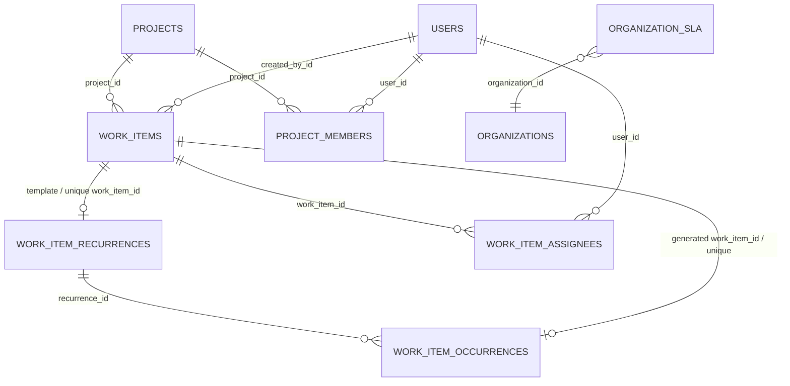

# Task Recurrence: Complete End-to-End Analysis

## Scope and verdict

This report describes the checked-in TypeScript source and migrations, not generated `backend/dist` output. It does not change application code. The key distinction is that the repository contains:

1. A **backend recurrence engine** that can create and schedule rules when a client sends the backend's `recurrence` DTO.
2. A **legacy frontend recurrence model** (`recurrenceRule`) used for a UI preview and client-side task generation.

The current frontend does not bridge those contracts. Its create form puts `recurrenceRule` in its local payload, but `AppContext.createTask` omits it from the `POST /api/work-items` body. The task detail drawer's save operation also does not send recurrence data to the backend. Therefore, the recurrence options visible in the normal frontend are not persisted as backend recurrence rules. The backend scheduler itself is implemented and can run rules created through a valid backend request.

## 1. Frontend analysis

### UI locations and controls

| File | Responsibility |
|---|---|
| [CreateTaskModal.tsx](frontend/src/components/tasks/CreateTaskModal.tsx) | Shows a “Recurrence Schedule” section while creating every work-item type. |
| [TaskDetailsDrawer.tsx](frontend/src/components/tasks/TaskDetailsDrawer.tsx) | Shows a Recurrence tab with a preview and a “Save Recurrence” button for an existing task. |
| [recurrence.ts](frontend/src/domain/recurrence.ts) | Formats rules, previews projected dates, and has a legacy function that constructs the next task on completion. |
| [AppContext.tsx](frontend/src/state/AppContext.tsx) | Maps create/update operations to backend API DTOs and invokes the legacy completion function. |
| [api.ts](frontend/src/services/api.ts) | Defines the backend create DTO and maps backend WorkItems to frontend `Task`s. |
| [index.ts](frontend/src/types/index.ts) | Defines the older frontend `RecurrenceConfig` and `Task` types. |

### Fields, accepted values, and defaults in the UI

The UI holds three recurrence values: `recFrequency` (initially `none`), `recInterval` (initially `1`), and `recWeekdaysOnly` (initially `false`).

| UI field | Values / range | Required? | Behavior |
|---|---|---|---|
| Frequency | `none`, `daily`, `weekly_monday`, `weekly`, `monthly_first_day`, `monthly_last_friday`, `monthly` | No; defaults to `none` | `none` means the form writes `{ frequency: "none" }` to its local `recurrenceRule`. Any other selection is treated as recurring by the legacy frontend engine. |
| Repeat interval | Number input, UI `min=1`, `max=30`; initial value `1` | Not formally required; the payload uses `Number(recInterval) || 1` | In the create modal it appears for `daily`, `weekly`, and `monthly` except when “Weekdays only” is checked. In the drawer it is always shown, but disabled for the three special legacy options. The UI does not provide a recurrence-specific validation message. |
| Weekdays only | Boolean checkbox, shown only for `daily` | No; defaults to `false` | The UI label says to skip Saturday and Sunday. It does not select arbitrary weekdays. |

The other displayed inputs, such as task `startDate` and `dueDate`, are ordinary work-item fields, not recurrence start/end fields. The recurrence UI has no recurrence-specific start date, end date, end count, timezone, time-of-day, monthly day number, or selectable weekdays. There is no `custom` option in either selector, though the legacy formatter has a `custom` branch.

The selectable frontend frequencies do not match the backend enum. For example, the UI's `weekly_monday` and `monthly_last_friday` are not backend `frequency` values; the backend represents those schedules as `WEEKLY` plus `daysOfWeek`, or `MONTHLY` plus `monthlyPattern`.

### What the frontend sends

`CreateTaskModal.handleSubmit` constructs this local fragment when daily recurrence is selected:

```json
{
  "recurrenceRule": {
    "frequency": "daily",
    "interval": 1,
    "weekdaysOnly": false,
    "endCondition": "never"
  }
}
```

That is **not** the HTTP request body. `AppContext.createTask` explicitly builds a `createWorkItemApi` request from selected task fields and does not include `recurrenceRule` or `recurrence`. The API's `CreateWorkItemApiInput` also has no recurrence property. A representative actual create request is therefore shaped like:

```json
{
  "projectId": "<project-uuid>",
  "sprintId": null,
  "parentWorkItemId": null,
  "plannedStartDate": null,
  "plannedDurationWorkingDays": null,
  "type": "TASK",
  "title": "Prepare the daily report",
  "description": null,
  "priority": "MEDIUM",
  "status": "BACKLOG",
  "dueDate": null,
  "assignees": [],
  "labelId": null,
  "labels": []
}
```

There is no recurrence field in that request, even if a frequency was selected in the form. The create call consequently creates a normal WorkItem and does not create a `work_item_recurrences` record.

### Editing, stopping, and previews

The drawer initializes its recurrence state from `task.recurrenceRule`, then its “Save Recurrence” handler calls `updateTask(task.id, { recurrenceRule: rule }, snapshotVersion)`. For persisted tasks, `AppContext.updateTask` builds a separate backend update object from an allowlist of ordinary task fields. It contains only `version` for a recurrence-only edit, and the code calls `updateWorkItemApi` only when that object has more than one key. Thus a recurrence-only save is applied to React state, not the server. `saveStateToStorage` deliberately does not save business records to localStorage, so this is not durable browser persistence either.

The backend mapper `backendWorkItemToTask` reads `recurrenceRule`, but not the backend response's `recurrence` entity; if no legacy property exists, it supplies `{ frequency: "none" }`. A backend recurrence therefore is not rehydrated into the frontend recurrence editor by this mapper.

Selecting “One-time” is the only UI-like stop control, but it does not deactivate a persisted backend rule. There are no pause/resume controls. In the legacy client path, `createNextRecurringTask` computes another task when a task transitions to a completed workflow status; this function does not call the backend create API. It creates a client-generated ID and `AppContext.changeTaskStatus` adds that task to the in-memory task list. That local occurrence is lost when business records are reloaded from the server.

The frontend preview is also legacy-only: it bases the next preview date on the task's due date, then start date, then today; it does not use backend `startsOn`, `endsOn`, `daysOfWeek`, `monthlyPattern`, `timezone`, or `nextRunAt`. In the drawer it is shown only when the task has a due date.

## 2. Backend API analysis

### Routes and behaviors

`backend/app.ts` mounts `work.item.routes.ts` at `/api/work-items`. There is **no recurrence-specific route**.

| Method and URL | Auth/permission | Recurrence behavior |
|---|---|---|
| `POST /api/work-items` | `isLoggedIn`; `task:create`; create schema validation | The only recurrence write path. Accepts an optional `recurrence` object along with the task and creates the rule in the same transaction. |
| `GET /api/work-items/:workItemId` | `isLoggedIn`; `task:read` | Returns the WorkItem, assignments, labels, and SLA snapshot; does not load or include the recurrence relation. |
| `GET /api/work-items/project/:projectId` | `isLoggedIn`; `task:read` | Lists WorkItems; does not join recurrence rules. |
| `PATCH /api/work-items/:workItemId` | `isLoggedIn`; `task:update`; update schema validation | Updates task fields, not recurrence. The update DTO has no `recurrence` field and rejects unknown properties. |
| `DELETE /api/work-items/:workItemId` | `isLoggedIn`; `task:delete` | Deletes the WorkItem; the recurrence FK cascades and deletes its rule/occurrence rows. Generated WorkItems are not deleted by that cascade. |

Authentication accepts the access token from bearer authorization or the `token` cookie. Create authorization additionally requires a project membership with `task:create`; project roles `ADMIN`, `LEAD`, and `MEMBER` have that permission in the current permission table.

### Backend request validation and persistence

The create validator accepts:

```json
{
  "recurrence": {
    "frequency": "DAILY | WEEKLY | MONTHLY",
    "interval": 1,
    "daysOfWeek": [1, 3],
    "monthlyPattern": "DAY_OF_MONTH | FIRST_DAY | LAST_FRIDAY",
    "dayOfMonth": 15,
    "startsOn": "YYYY-MM-DD",
    "endsOn": "YYYY-MM-DD or null",
    "timezone": "Asia/Kolkata",
    "weekdaysOnly": false
  }
}
```

This is a schema outline, not a valid single example: frequency-specific fields must follow the rules below.

* `frequency` and `startsOn` are required. `interval` defaults to `1`, must be an integer >= 1, and has no backend upper limit.
* `daysOfWeek`, when weekly, must be a non-empty array of unique integer PostgreSQL weekday numbers `0` to `6` (Sunday to Saturday). Weekly recurrence requires it.
* Monthly recurrence requires a valid `monthlyPattern`. `dayOfMonth` is required for `DAY_OF_MONTH`, with range 1–31, and forbidden for the other monthly patterns.
* `endsOn` is optional/null and must be a real `YYYY-MM-DD` date on or after `startsOn`.
* `timezone` defaults to `Asia/Kolkata`, and `validateRecurrence` rejects any other value.
* `weekdaysOnly` defaults to `false` and is valid only for `DAILY`.
* Recurrence cannot be attached to an `EPIC`. Extra keys are rejected by Joi.

`validateCreateWorkItem` applies Joi conversion/defaults, then `createWorkItemOrchestration` validates recurrence semantics. Invalid input is reported through the standard error handler as `{ success: false, code, message }` with a 400 status for validation errors. The create transaction saves the WorkItem, assignment/audit/SLA state, and then the recurrence entity. It maps the request fields to entity fields, fixes timezone/time to Asia/Kolkata/09:00, calculates `nextRunAt`, and sets `isActive` false if no future scheduled occurrence exists.

### Actual backend request/response examples

A request that can create a backend daily rule (unlike the current frontend request) is:

```http
POST /api/work-items
Content-Type: application/json
```

```json
{
  "projectId": "<project-uuid>",
  "type": "TASK",
  "title": "Prepare the daily report",
  "description": "Review the previous day's metrics.",
  "priority": "MEDIUM",
  "recurrence": {
    "frequency": "DAILY",
    "interval": 1,
    "startsOn": "2026-11-03",
    "endsOn": null,
    "timezone": "Asia/Kolkata",
    "weekdaysOnly": true
  }
}
```

For an authenticated user with the required project permission, the controller returns HTTP 201 and a body shaped as:

```json
{
  "success": true,
  "message": "Work item created successfully",
  "data": {
    "id": "<work-item-uuid>",
    "title": "Prepare the daily report",
    "status": "BACKLOG",
    "recurrence": {
      "id": "<recurrence-uuid>",
      "frequency": "DAILY",
      "interval": 1,
      "daysOfWeek": null,
      "monthlyPattern": null,
      "dayOfMonth": null,
      "startsOn": "2026-11-03",
      "endsOn": null,
      "nextRunAt": "<calculated timestamptz>",
      "timezone": "Asia/Kolkata",
      "timeOfDay": "09:00",
      "weekdaysOnly": true,
      "isActive": true
    }
  }
}
```

The real `data` contains the full WorkItem and additional response fields (labels, assignments, assignee IDs, and SLA snapshot). The recurrence relation is returned on create because `createWorkItem` explicitly includes `result.recurrence`; the GET controller does not do the equivalent relation lookup.

An update body containing `recurrenceRule` or `recurrence` is not accepted by `updateWorkItemSchema` (`unknown(false)`). No endpoint updates or explicitly deactivates an existing recurrence.

## 3. Database structure and relationships

### Recurrence-specific tables

`WorkItemRecurrence` maps to `work_item_recurrences`. PostgreSQL types and nullability below reflect the entity plus the migrations.

| Column | Type | Null/default/constraints |
|---|---|---|
| `id` | `uuid` | PK; generated UUID. |
| `work_item_id` | `uuid` | Unique FK to `work_items.id`, `ON DELETE CASCADE`. Initially `NOT NULL`; migration `1792266103953-ModifiedEntity` drops `NOT NULL`, while the TypeORM relation does not declare `nullable: true`. This is a schema/entity mismatch. |
| `frequency` | enum | Required; `DAILY`, `WEEKLY`, `MONTHLY`. |
| `interval` | `integer` | Required; default `1`; check constraint `interval > 0`. |
| `days_of_week` | `smallint[]` | Nullable; 0 Sunday through 6 Saturday. |
| `monthly_pattern` | enum | Nullable; `DAY_OF_MONTH`, `FIRST_DAY`, `LAST_FRIDAY`. |
| `day_of_month` | `smallint` | Nullable; application validation requires 1–31 for `DAY_OF_MONTH`. |
| `starts_on` | `date` | Required. |
| `ends_on` | `date` | Nullable; the final eligible date is inclusive. |
| `next_run_at` | `timestamptz` | Nullable. |
| `timezone` | `varchar(100)` | Required; final migration default `Asia/Kolkata`; API validation permits only this zone. |
| `time_of_day` | `varchar(5)` | Required; default `09:00`; currently compatibility data—the worker always uses the fixed constant 09:00. |
| `weekdays_only` | `boolean` | Required; default `false`; meaningful for daily recurrence. |
| `is_active` | `boolean` | Required; default `true`. |
| `created_at` | `timestamptz` | Required; TypeORM-generated creation time/default `now()`. |
| `updated_at` | `timestamptz` | Required; TypeORM-generated update time/default `now()`. |

Indexes/constraints: primary key on `id`; unique `work_item_id` (one rule per original WorkItem); `CHK_recurrence_interval_positive`; `IDX_recurrence_next_run` on `(is_active, next_run_at)`.

`WorkItemOccurrence` maps to `work_item_occurrences`:

| Column | Type | Null/default/constraints |
|---|---|---|
| `id` | `uuid` | PK; generated UUID. |
| `recurrence_id` | `uuid` | Required FK to `work_item_recurrences.id`, `ON DELETE CASCADE`. |
| `scheduled_for` | `date` | Required calendar date for this occurrence. |
| `work_item_id` | `uuid` | Required unique FK to generated `work_items.id`, `ON DELETE CASCADE`. |
| `created_at` | `timestamptz` | Required; generated creation time/default `now()`. |

Indexes/constraints: PK on `id`, unique `(recurrence_id, scheduled_for)` (`UQ_occurrence_recurrence_date`), unique `work_item_id`, and `IDX_occurrence_recurrence` on `recurrence_id`.

### Other tables directly used in the recurrence flow

The following are relevant fields from the actual entities; they are not recurrence-rule columns.

* **`work_items` / `WorkItem`:** `id uuid` PK; `organization_id uuid`; `project_id uuid`; `created_by_id uuid`; nullable `parent_work_item_id uuid`; `type` enum (`EPIC`, `STORY`, `TASK`, `SUBTASK`, `BUG`); `title varchar(255)`; nullable text `description`, `business_goal`, `success_criteria`, `acceptance_criteria`, `steps_to_reproduce`, `expected_behavior`, `actual_behavior`, `environment`; nullable `bug_severity varchar(20)`; nullable `estimated_hours numeric(8,2)`; `status` enum with default `BACKLOG`; nullable `priority` enum (`LOW`, `MEDIUM`, `HIGH`, `URGENT`); nullable `due_date timestamptz`; nullable `planned_start_date date`; nullable `planned_duration_working_days integer`; `is_schedule_pinned boolean` default false; nullable `sla_deadline timestamptz`; nullable `sla_status` enum; `sla_deadline_is_custom boolean` default false; nullable `escalated_at timestamptz`, `escalated_by_id uuid`, `escalation_reason text`, `sla_breached_at timestamptz`, `sla_resolved_at timestamptz`; `created_at`, `updated_at` timestamptz; `version integer` default 1; nullable `sprint_id uuid`; nullable `label_id uuid`. The entity has indexes for organization, project, creator, parent, project/status, project/type, and SLA deadline/status, plus a positive planned-duration check. Project and creator FKs are `RESTRICT`; parent deletion sets `parent_work_item_id` null; sprint/label deletion sets those IDs null.
* **`work_item_assignees` / `WorkItemAssignee`:** composite PK `(work_item_id uuid, user_id uuid)`; nullable `assigned_by_id uuid`; `assigned_at timestamptz`; nullable `start_date date`; nullable `estimated_hours numeric(8,2)`. WorkItem deletion cascades; assigned-user deletion is restricted; assigned-by deletion sets null. The recurrence worker copies assignments, not their start dates.
* **`projects` / `Project`:** `id uuid` PK; `organization_id uuid`; `name varchar(150)`; `key varchar(20)`; nullable `description text`, `start_date date`, `end_date date`; `created_by_id uuid`; `created_at`/`updated_at timestamptz`; `visibility` enum default `PRIVATE`. `(organization_id, key)` is unique; organization/creator FKs are restricted. There is no archive field.
* **`users` / `User`:** `id uuid` PK; nullable `organization_id uuid`; nullable `full_name varchar(100)`; unique `email varchar(255)`; nullable `password_hash varchar(255)`, `invite_token_hash varchar`, `invite_expires_at timestamptz`; `role` enum default `ADMIN`; `status` enum default `PENDING`; `created_at`/`updated_at timestamptz`. The worker requires the template creator to be `ACTIVE` and in the template's organization.
* **`project_members` / `ProjectMember`:** composite PK `(project_id uuid, user_id uuid)`; nullable `added_by_id uuid`; `role` enum default `MEMBER`; `joined_at timestamptz`. Project/user deletion cascades; added-by deletion sets null. The scheduler checks the original creator's membership and `task:create` permission before generating an occurrence.
* **`organization_sla` / `OrganizationSla`:** `id uuid` PK; unique `organization_id uuid`; `urgent_hours`, `high_hours`, `medium_hours`, `low_hours`, `escalate_hours` are `int` with defaults 4, 8, 24, 72, 8; `created_at`/`updated_at timestamptz`. Organization deletion cascades.
* **`audit_logs` / `AuditLog`:** `id uuid` PK; `organization_id uuid`; nullable `project_id uuid`; `user_id uuid`; `action varchar(50)`; `entity_type varchar(50)`; `entity_id varchar(100)`; `description text`; nullable `previous_state jsonb`, `new_state jsonb`; `is_undone boolean` default false; `trusted_for_undo boolean` default false; nullable `undone_at timestamptz`, `undone_by_id uuid`, `reversal_log_id uuid`; `created_at timestamptz`. The task-creation flow and SLA initialization can write here; the recurrence worker does not write a task-created audit event.
* **`notifications` / `Notification`:** `id uuid` PK; `user_id uuid`; `organization_id uuid`; `type` enum; `title varchar(255)`; `message text`; `read boolean` default false; nullable `read_at timestamptz`, `work_item_id uuid`, `project_id uuid`, `link varchar(255)`, `deduplication_key varchar(255)` (unique), `metadata jsonb`; `created_at timestamptz`. This table's enum contains recurring-task notification types, but the recurrence worker does not create notifications.

The recurrence rule itself has a unidirectional one-to-one relation to its template WorkItem. There is no recurrence property on the `WorkItem` entity. The occurrence row links the rule to each generated WorkItem; there is no direct foreign key from a generated WorkItem back to its original template.

### Migrations

* `1791980000000-AddMappedEntityTables.ts` creates the recurrence frequency/monthly-pattern enums, `work_item_recurrences`, `work_item_occurrences`, their checks, unique constraints, indexes, and cascading foreign keys.
* `1792266103953-ModifiedEntity.ts` rebuilds the recurrence/occurrence foreign keys and drops `NOT NULL` from `work_item_recurrences.work_item_id` in its `up` migration. This conflicts with the non-null TypeORM relation declaration.
* `1792752000000-AddRecurrenceTimeOfDay.ts` adds `time_of_day` defaulting to `09:00`.
* `1792760400000-AddWeekdaysOnlyToWorkItemRecurrence.ts` adds `weekdays_only`, changes the timezone default to `Asia/Kolkata`, and updates existing rows to 09:00/Asia-Kolkata. It also redundantly attempts to add `time_of_day` with `IF NOT EXISTS`.

The migrations are registered in `AppDataSource`. `server.ts` initializes the DataSource but does not call `runMigrations`; schema synchronization is controlled by `DB_SYNCHRONIZE` (false unless explicitly enabled). How deployment applies migrations is not established by this source review.

### ER diagram



The `||--o|` notation for the template is the intended one-rule-per-template relationship; the current migration's nullable `work_item_id` weakens the database-level non-null guarantee.

### Example stored records

These are illustrative values matching the schema, not records read from the database:

```text
work_items
  id=<template-uuid>, project_id=<project-uuid>, created_by_id=<user-uuid>
  type=TASK, title="Prepare the daily report", status=BACKLOG
  priority=MEDIUM, due_date=NULL

work_item_recurrences
  id=<recurrence-uuid>, work_item_id=<template-uuid>
  frequency=DAILY, interval=1, days_of_week=NULL
  monthly_pattern=NULL, day_of_month=NULL
  starts_on=2026-11-03, ends_on=NULL
  next_run_at=2026-11-03T03:30:00Z
  timezone=Asia/Kolkata, time_of_day=09:00
  weekdays_only=true, is_active=true

work_item_occurrences (after generation)
  id=<occurrence-uuid>, recurrence_id=<recurrence-uuid>
  scheduled_for=2026-11-03, work_item_id=<generated-uuid>
```

## 4. Recurrence execution workflow

### Exact backend sequence

1. A client submits `POST /api/work-items` with a valid backend `recurrence` object.
2. `validateCreateWorkItem` validates the request. `createWorkItemOrchestration` rejects recurring EPICs and calls `validateRecurrence`.
3. In a TypeORM transaction, the service authorizes the project, validates parent/sprint/labels/assignees, and saves the template WorkItem and its normal fields.
4. The same transaction saves the task's audit/SLA data and assignment rows. If `recurrence` was supplied, it creates `WorkItemRecurrence` with the fixed timezone/time, the date pattern, and `isActive: true`.
5. `getInitialOccurrenceRunAt` finds the first eligible **future calendar date** and converts 09:00 Asia/Kolkata to a UTC instant. The result is saved as `nextRunAt`. If there is no eligible future date, it is saved inactive with `nextRunAt = null`.
6. On server startup, `startScheduler` starts a Croner recurrence job with expression `* * * * *` (once per minute). It does not immediately invoke recurrence processing at startup.
7. `processDueRecurrences(25)` loops through at most 25 due rule-processing transactions per scheduler tick.
8. Each `processOneDueRecurrence` opens a database transaction. It selects the earliest active recurrence whose non-null `nextRunAt <= now`, inner-joins the template, and uses a pessimistic write lock with `SKIP LOCKED`.
9. It checks that the template project and active creator still exist and that the creator still has project membership with `task:create`. If not, it deactivates the rule and clears `nextRunAt`.
10. It derives `scheduledFor` from `nextRunAt` in the rule timezone and checks for an existing `(recurrenceId, scheduledFor)` occurrence.
11. If this date has not already been processed and is within the inclusive end date, it creates a new WorkItem and initializes SLA state.
12. It copies the template assignments and inserts a `WorkItemOccurrence` linking the recurrence and generated WorkItem.
13. It computes the next eligible date. If none exists (or it is beyond `endsOn`), the rule is deactivated and `nextRunAt` cleared; otherwise, the next 09:00 local run instant is stored. The transaction commits all task, assignment, occurrence, SLA, and rule changes together.

### Generated WorkItem fields

Copied from the template: `organizationId`, `projectId`, `createdById`, `parentWorkItemId`, `type`, `title`, `description`, and `priority`.

Reset or recalculated: `status` is `BACKLOG`; `dueDate` is `null`; SLA state is cleared and recalculated from the generated task's `createdAt` when it has a priority; `sprintId` is `null`. Generated assignee rows copy `userId` and `estimatedHours`, set `assignedById` to the template creator, and set assignment `startDate` to null.

Not copied: task-specific business/acceptance/bug fields, planned dates/duration, pinned schedule, labels, attachments, comments, time entries, dependencies, and any recurrence configuration. The generated item does not receive a new recurrence rule.

### Transactions, locking, duplicates, and failures

Generation is transactional. The rule row lock and `SKIP LOCKED` coordinate concurrent workers, including separate server processes; an in-process `isRecurrenceJobRunning` guard also prevents overlap in one process. A unique constraint on `(recurrence_id, scheduled_for)` and an existence check provide additional duplicate protection. The unique `work_item_id` in the occurrence table ensures an occurrence record cannot point to the same WorkItem as another record.

If any database operation in a processing transaction fails, the transaction rolls back, including the created WorkItem and next-run update. The scheduler catches/logs the error; because the recurrence remains due, a later minute's job retries it. There is no explicit retry counter or recurrence-failure deactivation. Scheduler error logs are rate-limited per scheduler name.

On restart, overdue `nextRunAt` values remain eligible. The worker catches up one scheduled date at a time; the per-tick limit is 25 processing transactions. During a large backlog, a single old recurrence can be processed repeatedly because each loop again selects the earliest due rule.

### Sequence diagram

```mermaid
sequenceDiagram
  participant F as Frontend
  participant A as API route/controller
  participant S as Work-item service
  participant D as PostgreSQL
  participant J as Croner scheduler
  participant R as Recurrence service
  F->>A: POST /api/work-items with recurrence
  A->>S: validate and createWorkItemOrchestration
  S->>D: transaction: save template, assignments, recurrence
  S->>S: calculate initial nextRunAt (09:00 Asia/Kolkata)
  S-->>F: 201 created + recurrence in response
  J->>R: every minute processDueRecurrences(25)
  R->>D: transaction + SELECT due rule FOR UPDATE SKIP LOCKED
  R->>D: validate project/owner membership
  R->>D: create generated WorkItem, SLA state, assignments
  R->>D: insert WorkItemOccurrence
  R->>R: compute next eligible date or deactivate
  R->>D: update recurrence.nextRunAt / isActive; commit
```

## 5. Recurrence calculation logic

### Shared scheduling rules

`isEligibleDate` compares date-only values. `interval` is anchored to `startsOn`. `getInitialOccurrenceRunAt` uses the current date in the rule timezone and skips any candidate whose date is today or earlier—even if 09:00 has not yet passed—because the original task already exists. The first generated item is therefore always on a date strictly later than the current local calendar date.

`getRecurrenceRunAt` fixes the intended local time to `09:00` and converts it to a UTC instant using `Intl.DateTimeFormat` and iterative offset correction. The API accepts only `Asia/Kolkata`; that zone does not currently have daylight-saving transitions. The code's offset conversion could account for DST if a stored row used another timezone, but non-IST zones are rejected at API validation.

### Daily

For a candidate date, the day difference from `startsOn` must be nonnegative and divisible by `interval`. If `weekdaysOnly` is true, Saturday and Sunday candidates are rejected. This is an every-N-calendar-days pattern with weekend candidates skipped, not an every-N-business-days interval. Weekends are otherwise allowed.

Example: with `startsOn=2026-11-03`, `interval=1`, and weekdays-only enabled, the first run is Tuesday 2026-11-03 at 09:00 IST (`2026-11-03T03:30:00Z`). The next eligible weekday is Wednesday 2026-11-04 at the same local time.

### Weekly

The service computes the Sunday-starting week containing `startsOn` and the candidate. A candidate is eligible when its week difference is divisible by `interval` and its weekday number appears in `daysOfWeek`. There is no weekday-only restriction for weekly schedules; weekend days are selectable.

Example: `startsOn=2026-11-03` (Tuesday), `interval=1`, and `daysOfWeek=[2,4]` (Tuesday and Thursday) schedules Tuesday 2026-11-03 at 09:00 IST, then Thursday 2026-11-05. For interval 2, only alternating Sunday-based week buckets qualify.

### Monthly

The month difference from the month containing `startsOn` must be divisible by `interval`.

* `DAY_OF_MONTH` matches only when `getUTCDate()` equals `dayOfMonth`.
* `FIRST_DAY` matches day 1.
* `LAST_FRIDAY` matches a Friday for which adding seven days would move beyond the month's last day.

Invalid month dates are **skipped**, not clamped. A `DAY_OF_MONTH=31` schedule has no February occurrence and no occurrence in a 30-day month. It resumes in a later eligible month that contains day 31. Weekends are not otherwise excluded.

Example: a `DAY_OF_MONTH=31`, interval 1 rule anchored in November 2026 has no November 31 occurrence; the next eligible date is December 31, 2026 at 09:00 IST. For a `FIRST_DAY` rule with a future `startsOn=2026-12-01`, the run is December 1 at 09:00 IST.

### Bounds and examples of date handling

`getNextOccurrenceDate` and initial-run search are bounded to 36,600 calendar days (roughly 100 years) per search. This is a search bound, not a configured occurrence limit. Normal daily/weekly/monthly recurrences with no `endsOn` can continue indefinitely. If a valid recurrence has no eligible date inside the search window, the service returns null and the rule is inactive or is subsequently deactivated.

Date strings are validated as actual calendar dates in `YYYY-MM-DD` form. An end date before the start date is rejected. Starts in the past are allowed, but initial scheduling starts from the recurrence anchor and chooses a future eligible date; it does not generate a retroactive backlog for dates before the first stored `nextRunAt`.

## 6. When and how recurrence stops

| Condition | Actual backend behavior |
|---|---|
| `endsOn` reached | The date is inclusive: an occurrence with `scheduledFor <= endsOn` can be generated. After that occurrence, if there is no next eligible date within the end date, the recurrence is set inactive and `nextRunAt` becomes null. |
| `isActive=false` | Excluded from the due query. No recurrence-management endpoint currently sets this flag. |
| Original task completed | No backend check of template status; completion does not stop or trigger backend recurrence. |
| Generated task completed | Generated tasks have no recurrence relation of their own; completion does not change the original rule. |
| Original task deleted | FK cascade deletes its recurrence and occurrence rows, stopping future runs. Previously generated WorkItems remain because deletion of their occurrence rows does not cascade in reverse to those WorkItems. |
| Generated task deleted | Its occurrence row is deleted by FK cascade. The recurrence's already-advanced `nextRunAt` is not rewound, so that past occurrence is not recreated. |
| Project archived | No archive field or archive operation is present in `Project`; the scheduler does not check project `endDate` or visibility. |
| Project deleted | `WorkItem.project` uses `ON DELETE RESTRICT`; `deleteProject` removes the Project without first removing its WorkItems. A project with WorkItems therefore cannot normally be deleted successfully under the declared FK policy. |
| Owner/user/member invalid | When a due rule is processed, missing project, missing/inactive creator, missing project membership, or lost `task:create` permission deactivates it and clears `nextRunAt`. |
| Generation failure | Transaction rollback leaves the rule due and active; the next scheduler run may retry. |
| Maximum number of occurrences | No count/limit column or count-based stop condition exists. With no end date, a normal rule continues indefinitely. |

The frontend legacy helper has a separate `endCondition`/`endDate` model, but its `occurrences` count is not enforced by `createNextRecurringTask`; those legacy fields do not control the backend scheduler.

## 7. Generated task lifecycle

For every due date, the backend creates one fresh WorkItem from the original template's selected fields. Its title and description are copied unchanged; its status is `BACKLOG`; its priority is copied. Its `dueDate` is explicitly null—the scheduled date lives in `work_item_occurrences.scheduled_for`, not on the generated WorkItem. There is no generated planned start date or duration.

The project, organization, original creator, parent item, type, title, description, and priority are copied. The parent relationship is therefore to the template's parent (if any), not to the original recurring WorkItem. Assignees are copied with estimated hours but a null assignment start date. Labels, attachments, comments, time entries, dependencies, bug/story/epic detail fields, sprint assignment, and the recurrence itself are not copied.

The original-to-generated connection is:

```text
template WorkItem
  <- work_item_recurrences.work_item_id
  <- work_item_occurrences.recurrence_id
  -> work_item_occurrences.work_item_id
  -> generated WorkItem
```

The occurrence row stores its scheduled date and creation time, but no occurrence number, attempt count, execution history, or scheduler actor. The occurrence table is the only explicit provenance link.

Generated tasks are ordinary WorkItems and can be edited/deleted through normal APIs. Their edits do not affect the recurrence template, and no generated task has a recurrence rule of its own.

## 8. Notifications, audit logs, and SLA integration

* **Initial creation:** The regular task-creation orchestration writes an `AuditLog` task-created entry. After the transaction, it sends best-effort `TASK_ASSIGNED` notifications to assigned users other than the creator. Its audit `newState` does not include recurrence configuration, and the notification describes assignment, not recurrence creation.
* **Automatic occurrence:** The recurrence service does not call the notification service or write a task-created AuditLog entry. The notification enum contains `RECURRING_TASK_CREATED` and `RECURRING_TASK_FAILED`, but their presence in the enum is not evidence that the worker uses them.
* **Actor attribution:** The generated WorkItem's `createdById` is the template creator. There is no scheduler actor column in `WorkItemOccurrence`. If generated-task SLA initialization writes an audit entry, it passes the template creator's ID as the audit actor.
* **SLA:** For a generated task with a priority, the worker loads the organization's SLA policy, calculates a deadline from the generated WorkItem's `createdAt`, applies current SLA state, and writes an SLA audit entry. Without priority it clears all SLA fields. The task-created recurrence path does not require priority; no SLA deadline is initialized without it. The separate SLA scheduler refreshes state every minute.
* **Conflict:** There is no separate recurrence notification transaction to conflict with generation. SLA initialization is inside the recurrence database transaction, so an SLA/audit failure rolls back generation and leaves the due rule to retry. Best-effort notification delivery is not part of this generated-task transaction because no such notification is sent.

## 9. Edge cases, defects, and potential risks

No P0 issue was found in the reviewed recurrence path. The row lock, transaction, due-time query, existence check, and occurrence uniqueness constraint are protections against duplicate worker generation.

| Priority / status | File and function | Current behavior and why it matters | Reproduction / expected vs actual |
|---|---|---|---|
| **P1 — confirmed functional defect** | `frontend/src/components/tasks/CreateTaskModal.tsx` (`handleSubmit`); `frontend/src/state/AppContext.tsx` (`createTask`); `frontend/src/services/api.ts` (`CreateWorkItemApiInput`) | UI stores `recurrenceRule` in a frontend-only shape. `createTask` maps selected fields into an explicit backend DTO and drops the recurrence rule; that DTO does not declare either recurrence property. The server sees a normal task and creates no recurrence row. | Select Daily in Create Work Item and submit. Expected: recurrence is persisted and later generated. Actual: `POST /api/work-items` contains no recurrence; no backend rule is scheduled. |
| **P1 — confirmed functional defect** | `frontend/src/components/tasks/TaskDetailsDrawer.tsx` (`handleSaveRecurrence`); `frontend/src/state/AppContext.tsx` (`updateTask`, `changeTaskStatus`); `frontend/src/services/api.ts` (`backendWorkItemToTask`) | Recurrence save is not included in the backend update allowlist; with only `version` in the backend update map, no PATCH is sent. The mapper also ignores the backend `recurrence` entity and defaults the legacy rule to `none`. On completion, the legacy helper creates a random-ID WorkItem only in React state, not through the backend. | Open a persisted task, save a daily rule, then complete it. Expected: persisted recurrence state and a server-created occurrence. Actual: the rule is only in frontend state, the completion path may show a local generated task, and a server reload loses the unsaved rule/task. |
| **P1 — missing backend capability** | `backend/routes/work.item.routes.ts`; `backend/validations/work.item.validations.ts` (`updateWorkItemSchema`); `backend/controllers/task.controller.ts` (`getWorkItemById`, `updateWorkItem`) | There is no recurrence GET/update/deactivate endpoint. GET does not load the relation, PATCH rejects recurrence keys, and no pause/resume API exists. A backend rule created by a valid direct API call can run, but the current frontend cannot reliably read or manage it. | Create a recurrence with the backend DTO, then fetch/update the WorkItem. Expected for a manageable recurrence: its rule is returned and can be edited/stopped. Actual: GET omits it and PATCH does not accept a rule. |
| **P2 — schema/entity mismatch; data-integrity risk** | `backend/entities/work.item.recurrence.entity.ts`; `backend/migrations/1792266103953-ModifiedEntity.ts` | The entity models a required one-to-one WorkItem relation, but the migration drops `NOT NULL` from `work_item_recurrences.work_item_id`. A null-linked record could exist at the DB level; the worker's inner join would never select it, so it would not be processed. The normal validated creation path supplies a WorkItem, so this is a schema risk rather than a reproduced normal-flow failure. | Directly insert a recurrence with null `work_item_id` where DB constraints permit it. Expected schema/entity consistency; actual entity metadata and migrated schema disagree, and the recurrence is invisible to the worker's inner join. |

### Other checked edge conditions (behavior, not asserted defects)

* Daily weekdays-only skips weekend dates; weekly schedules can select weekends.
* A monthly day 29/30/31 that does not occur in a month is skipped, not adjusted to that month's last day.
* Intervals greater than 30 are accepted by the backend (the UI merely sets an input `max=30`; backend validation has no maximum).
* `startsOn` today is skipped by initial scheduling regardless of whether 09:00 has passed. A past start date remains the interval anchor.
* The scheduler runs once per minute, so processing is not exact to the second of 09:00. It does not run immediately at startup; after downtime, due rules are eligible on a subsequent tick.
* A large overdue backlog is throttled to 25 processing transactions per tick. No retry cap exists; a persistently failing record can be retried every minute and logged at a rate-limited cadence.
* API timezone validation prevents user-selected DST zones. Current default Asia/Kolkata has no DST shift.
* No recurrence-focused backend test file was found. `frontend/tests/recurrence.test.ts` exercises the older client-side helper (including legacy Monday/monthly aliases), not the backend scheduler or API contract. `backend/e2e-feature-check.ts` is a diagnostic SQL query over recurrence records, not an automated scheduler test.

## 10. File dependency map

### Frontend components/pages and domain

* `frontend/src/components/tasks/CreateTaskModal.tsx` — create-time recurrence selector and local `recurrenceRule` payload.
* `frontend/src/components/tasks/TaskDetailsDrawer.tsx` — edit UI, save callback, and projected-occurrence preview.
* `frontend/src/domain/recurrence.ts` — legacy date calculation, text formatting, preview generation, and client-side completion generation.
* `frontend/src/domain/workItems.ts` — sanitizes generic work-item data and documents `recurrenceRule` as a frontend common field; it does not bridge it to the API.
* `frontend/src/components/activity/AuditEventDetailsDialog.tsx` — formats a `recurrenceRule` if one exists in a frontend audit payload.
* `frontend/src/state/storage.ts` — explicitly does not persist business records to localStorage.

### Frontend API, types, and context

* `frontend/src/state/AppContext.tsx` — create/update request mapping, backend task status changes, and use of `createNextRecurringTask`.
* `frontend/src/services/api.ts` — create/update API functions, `CreateWorkItemApiInput`, and `backendWorkItemToTask` mapping.
* `frontend/src/types/index.ts` — legacy `RecurrenceConfig` and frontend `Task` types; they do not model the backend recurrence DTO completely.

### Backend routes, controller, validation, and authorization

* `backend/app.ts` — mounts `/api/work-items`.
* `backend/routes/work.item.routes.ts` — create/read/update/delete WorkItem routes; no recurrence-specific route.
* `backend/controllers/task.controller.ts` — create response includes recurrence; read/update/delete controllers do not manage recurrence separately.
* `backend/validations/work.item.validations.ts` — Joi recurrence create schema and task update allowlist.
* `backend/middleware/is.loggedin.ts` — access-token authentication.
* `backend/middleware/project.permission.ts` — project membership and permission enforcement.
* `backend/middleware/async.handler.ts`, `backend/middleware/error.handler.ts`, `backend/errors/app.error.ts` — async/error response flow.

### Backend services and scheduler

* `backend/services/work-item.service.ts` — validates task creation, creates the template and recurrence in one transaction, creates ordinary assignment/task audits, and handles task updates.
* `backend/services/recurrence.service.ts` — validation, date eligibility, timezone conversion, due-rule selection/locking, generated WorkItem/assignee/occurrence creation, and next-run/deactivation.
* `backend/services/scheduler.service.ts` — Croner jobs, one-minute recurrence cadence, batch limit, in-process overlap guard, error logging.
* `backend/server.ts` — initializes the DB and starts/stops the scheduler.
* `backend/services/sla.service.ts` — deadline/state/audit helpers invoked for generated tasks.
* `backend/services/notification.service.ts` — best-effort initial assignment notifications; not called by recurrence generation.

### Entities, migrations, tests, and diagnostics

* `backend/entities/work.item.recurrence.entity.ts` — `WorkItemRecurrence`.
* `backend/entities/work.item.occurrence.entity.ts` — `WorkItemOccurrence`.
* Supporting entities used by the flow: `work.item.entity.ts`, `work.item-assignee.entity.ts`, `project.entity.ts`, `user.entity.ts`, `project.member.entity.ts`, `organization.sla.entity.ts`, `audit.log.entity.ts`, and `notification.entity.ts`.
* `backend/config/data.source.ts` — registers recurrence entities and migration files.
* `backend/migrations/1791980000000-AddMappedEntityTables.ts`, `1792266103953-ModifiedEntity.ts`, `1792752000000-AddRecurrenceTimeOfDay.ts`, and `1792760400000-AddWeekdaysOnlyToWorkItemRecurrence.ts` — create/change recurrence schema.
* `frontend/tests/recurrence.test.ts` — tests legacy frontend recurrence calculations and task generation.
* `backend/e2e-feature-check.ts` — diagnostic query that joins WorkItems, recurrences, and occurrences.

## 11. End-to-end examples and explanation

### Daily example

Assume the backend request is received on 2026-11-02 and specifies `frequency=DAILY`, `interval=1`, `startsOn=2026-11-03`, `weekdaysOnly=true`, no end date. The first next run is 2026-11-03 at 09:00 Asia/Kolkata (`2026-11-03T03:30:00Z`). The worker creates a new `BACKLOG` WorkItem on the next eligible minute tick, records `scheduled_for=2026-11-03`, then schedules the next weekday.

### Weekly example

With `frequency=WEEKLY`, `interval=1`, `daysOfWeek=[2,4]`, and `startsOn=2026-11-03`, the schedule is Tuesday/Thursday. The first run is Tuesday 2026-11-03 at 09:00 IST; after generation the next run is Thursday 2026-11-05 at 09:00 IST.

### Monthly example

With `frequency=MONTHLY`, `monthlyPattern=DAY_OF_MONTH`, `dayOfMonth=31`, `interval=1`, and a November 2026 anchor, November has no eligible day 31. The next occurrence is December 31, 2026 at 09:00 IST. The worker skips November rather than shifting to November 30.

### Original, recurrence, and generated records

The original WorkItem is the template; its unique recurrence row owns the schedule. Each execution creates an ordinary new WorkItem and one occurrence row that points to both the recurrence and generated WorkItem. The original task is not mutated into the next occurrence. The generated WorkItem has the same template title and basic task details but no due date, no copied label/attachments/dependencies, and no recurrence of its own. Its occurrence row is the only direct provenance link back through the recurrence to the template.

### Actual implemented flow in one paragraph

When a backend client creates a WorkItem with the server's `recurrence` DTO, the API validates and persists the template and recurrence in one transaction, computes the first future 09:00 Asia/Kolkata run, and returns both the WorkItem and recurrence entity. Croner checks for due rules once per minute. A locked transaction creates a new WorkItem, its assignees, an occurrence record, and priority-dependent SLA state; then it advances `nextRunAt` or deactivates the rule after the inclusive end date. This sequence is not currently connected to the recurrence controls in the frontend: the frontend submits no backend recurrence object, and its older local completion helper is not a substitute for server persistence.

## 12. Final audit report

* **Implemented:** backend recurrence entity/schema; daily, weekly, and monthly rules; timezone conversion to fixed 09:00 Asia/Kolkata; transaction/locking/idempotency controls; one-minute Croner polling; generated WorkItems and occurrence links; inclusive date end; automatic deactivation when no eligible date remains or the owner/project authorization is invalid; conditional generated-task SLA setup.
* **Partially implemented:** frontend recurrence controls, summary, preview, and legacy local generation; backend create support and create response. These exist independently and do not form a working frontend-to-backend feature path.
* **Missing:** frontend backend DTO mapping; recurrence read/update/pause/resume/deactivate APIs; UI recurrence start/end/timezone/weekday/monthly-date inputs; generated-task due-date assignment; generated-task notification/task-created audit; count-based termination; backend scheduler-focused automated tests.
* **Highest impact finding:** normal frontend users can select and save recurrence-looking settings, but those settings are not persisted as backend recurrence rules. Backend automatic generation only operates on recurrence rows created using the backend DTO.
* **Confirmed duplicate-generation finding:** none in the reviewed path. Transactional row locking, `SKIP LOCKED`, the occurrence existence check, and the unique occurrence/date constraint all mitigate duplicate generation.
